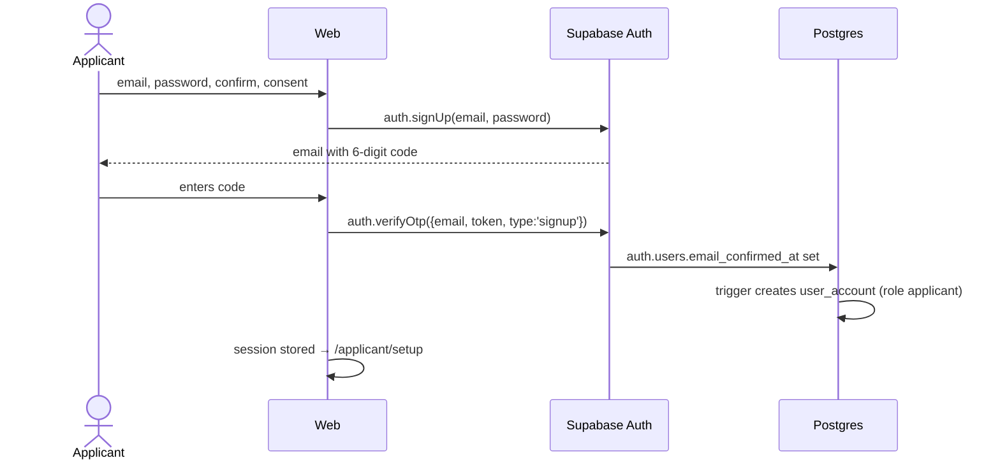
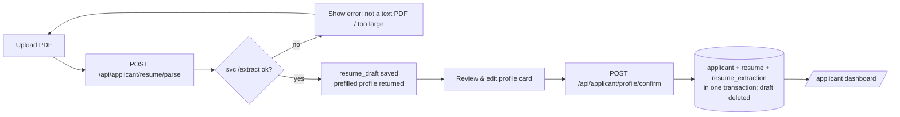
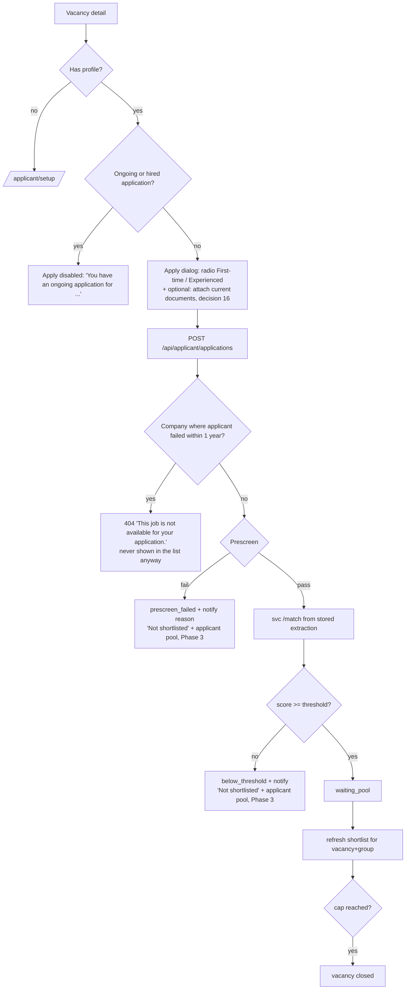
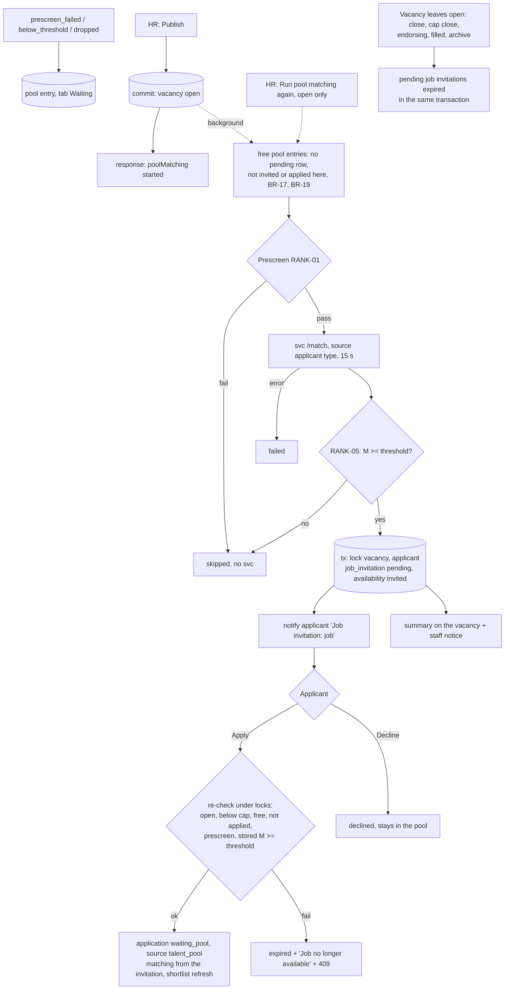

# VERA — App Flow

> How users move through VERA: routes, screens, flows, and state machines.
> Requirements live in [PRD](./PRD.md); endpoints in [TRD](./TRD.md) §6; tables in [DATABASE_SCHEMA](./DATABASE_SCHEMA.md).

---

## 1. Route map (`apps/web`)

### 1.1 Public
| Route | Screen | Notes |
|---|---|---|
| `/login` | Login | email/password, remember me, forgot password, Google, link to sign up |
| `/signup` | Applicant sign-up | email, password, confirm, privacy consent |
| `/signup/verify` | Enter 6-digit code | resend code (60 s cooldown) |
| `/forgot-password` | Request reset link | |
| `/reset-password` | Set new password | opened from the email link |
| `/auth/callback` | OAuth / email link landing | resolves session, then role redirect |

### 1.2 Applicant (`role = applicant`)
| Route | Screen | Sidebar |
|---|---|---|
| `/applicant/setup` | Upload resume → review profile → confirm | (sidebar disabled until done) |
| `/applicant` | Dashboard (profile card, status panel, interview, notifications) | My Profile |
| `/applicant/jobs` | Job Vacancies list | Job Vacancies |
| `/applicant/jobs/:vacancyId` | Vacancy detail + Apply | Job Vacancies |
| `/applicant/documents` | My Documents (Resume tab, Supporting tab, Requests) | My Documents |
| `/applicant/notifications` | All notifications | (bell in header) |

### 1.3 Admin / HR (`role = admin | hr`)
| Route | Screen | Sidebar |
|---|---|---|
| `/admin` | Dashboard | Dashboard |
| `/admin/companies` · `/admin/companies/:id` | Company List · Company detail | Company List |
| `/admin/vacancies` · `/admin/vacancies/new` · `/admin/vacancies/:id` · `/admin/vacancies/:id/edit` | Vacancies · form · detail (ranking) | Job Vacancies |
| `/admin/applicants` · `/admin/applicants/:id` | Applicant Management · applicant detail *(Sprint S18: the detail page is cut, so `/:id` stays a placeholder; §4.7)* | Applicant Management |
| `/admin/screening` · `/admin/screening/:vacancyId` · `/admin/screening/:vacancyId/:applicationId` | Resume Screening | Resume Screening |
| `/admin/interviews` · `/admin/interviews/:vacancyId` | Interview Assessment | Interview Assessment |
| `/admin/endorsements` · `/admin/endorsements/:vacancyId` | Endorsement Management: tabs Candidates · Outcomes · Post-hiring | Endorsement Management |
| `/admin/talent-pool` | Applicant Pool (talent pool): tabs Waiting · Invited *(Sprint S17: one minimal list, no tabs, §4.6)* | Applicant Pool |
| `/admin/reports` | Recruitment Reports *(optional, P9.6)* | Recruitment Reports |
| `/admin/settings` | Deadlines & defaults | Settings |
| `/admin/users` | HR accounts (**admin only**) | User Management |
| `/admin/competencies` | Fixed competency list (**admin only**) | Competencies |
| `/admin/notifications` | All notifications | (bell in header) |

Route guards: `RequireAuth` → `RequireRole(['applicant'])` / `RequireRole(['admin','hr'])` → (applicant only) `RequireProfile` (redirects to `/applicant/setup` if no profile).

---

## 2. Authentication flows

### 2.1 Sign-up with code
> *Sprint (ROADMAP S6, simplified):* Supabase emails a confirmation **link** instead of a code. The link opens `/auth/callback` → session → `/applicant/setup`; if it opens in another browser or device, the page says "Your email is confirmed. Please log in." (TRD §7.2).


### 2.2 Login and role redirect
1. `supabase.auth.signInWithPassword` (or `signInWithOAuth({provider:'google'})` → `/auth/callback`).
2. Storage chosen by **Remember me**: checked → `localStorage`; unchecked → `sessionStorage`.
3. Web calls `GET /api/me` → `{ role, account_status, hasProfile }`.
4. Inactive → sign out + message. `admin|hr` → `/admin`. `applicant` → `/applicant` or `/applicant/setup`.

### 2.3 Forgot password
`/forgot-password` → `auth.resetPasswordForEmail(email, { redirectTo: <origin>/reset-password })` → email link → `/reset-password` → `auth.updateUser({ password })` → `/login`.

---

## 3. Applicant flows

### 3.1 First-time setup


### 3.2 Apply
One ongoing application at a time (BR-17); vacancies of a company where the applicant failed within the last year are hidden (BR-19, decision 5); every application gets fresh matching (BR-20): experience = relevance only (no minimum years, decision 11), and a missing skills or experience section is replaced by the whole resume text (decision 12).


### 3.3 Respond to requests
- **Document request** (dashboard action card + My Documents → Requests): upload the requested type before `due_at`.
- **Upload document** (My Documents, decisions 29–30): the dialog has the title, **Document type** with only **Certificate, Diploma, Other**, a name field for Certificate (optional) / Other (required), and the PDF file area ("PDF only, up to 10 MB."); no helper line under the title. HR requests (§4.2) offer the same three types.
- **Interview** (pop-up): *Confirm* or *Request reschedule* (reason). Shows meeting link once confirmed. *(Phase 4, decision 20: built. The pop-up offers "Request a new time" and the dashboard card **Request reschedule** while requests are left and the interview has not started; a reason is required; while it waits the card says "Reschedule requested. The agency will set a new time or keep this one.")* *(Sprint, S13: the pop-up opens on the dashboard while an interview awaits confirmation and offers **Confirm attendance** only; reschedule requests are deferred, so an applicant who can't attend contacts the agency. Job title only, never the company; times in Philippine time. The dashboard's Upcoming interview card keeps the button and shows the link after confirming.)*
- **Endorsement confirmation** (pop-up): *Confirm* or *Decline*.
- **Suggested vacancy** *(S17, to be revised)*: HR offers a vacancy from the applicant pool; the applicant accepts or declines. Accepting starts a normal application (§3.2).
- **Job invitation** *(Phase 3, decision 17e; §3.8)*: same pop-up and dashboard row as a job offer, titled **Job invitation**, with **Apply** / **Decline**. Apply → a normal application at `waiting_pool` (then the shortlist); decline → stays in the pool.

### 3.4 Replace resume (My Documents → Resume tab)
Allowed only if no active application. Upload → parse → review profile diff (current vs extracted) → confirm → old resume archived/deleted → verification reset.

*(Phase 4, decision 16, built — replaces the rule above:)* **Re-upload** on the resume row opens **Replace resume**: choose a PDF → "Reading your resume…" (svc /extract; an unreadable PDF shows the svc message) → "{file} is ready" + reading notes → **Use this resume** → toast "Resume replaced. The agency will check it again." Allowed **during active applications**: applications already sent keep their resume and matching (HR sees that resume); new applications use the new one, which starts *For verification*. The profile does not change (no diff screen; edit it in My Profile). While a job offer or job invitation is pending the dialog shows "Answer your pending job offer or invitation first." (409).

**Attach documents when applying** *(decision 16)*: the Apply dialog lists the applicant's current supporting documents under "Attach documents to this application?" (none checked, **Select all**). With no documents it says "You have no documents yet. Upload them in My Documents; the agency may request them later." Attaching is optional and changes nothing in verification; HR sees the badge **Attached when applying** on those documents in the review sheet (§4.2).

### 3.5 Applicant status panel (dashboard)
One row per application: vacancy title, applicant type, applied date, **stage label** (mapping in §6), next action + deadline if any. While one row is ongoing or hired, the job list and job detail show why Apply is unavailable (BR-17).

### 3.6 Applying again after an unsuccessful application
After a final outcome other than `hired` the applicant may apply elsewhere (BR-18). Outcome classes (BR-19):

| Class | Statuses | Effect |
|---|---|---|
| ongoing | waiting_pool, shortlisted, interview_scheduled, interview_confirmed, passed, passed_awaiting_confirmation, for_endorsement, endorsed | blocks applying |
| hired | hired | blocks applying until training_failed |
| failed | did_not_pass, not_hired, training_failed, dropped | frees the applicant **and** hides every vacancy of that company from them |
| neutral | prescreen_failed, below_threshold, not_selected, standby, archived, terminated | frees the applicant, no company block |

If the applicant has a completed evaluation, the new application reuses its 15 ratings (BR-21, §4.2).

### 3.7 Automatic rematch after a client rejection *(S17; PRD BR-23, sprint note)*
```mermaid
flowchart TD
  NH[HR: Mark as not hired] --> C1[(commit: application not_hired<br/>pool entry not_hired)]
  RA[HR: Run rematch again] --> PRE
  C1 --> PRE{not_hired, pool entry from it active,<br/>applicant free BR-17, no pending offer?}
  PRE -- no --> E409[409 - Run again only; the hook returns failed]
  PRE -- yes --> F[Candidate vacancies, one SQL: open, not a failed company BR-19,<br/>endorsement not full, never applied BR-14,<br/>never offered from this pool entry]
  F --> M[per vacancy, sequential, NO transaction:<br/>prescreen RANK-01 → svc /match MAT-04, carried-over type<br/>→ RANK-02 rounding → WSM-01/03 original ratings × its weights → FIN-01]
  M -->|svc error / anything throws| FAIL[outcome response rematch: failed<br/>Run again: 503]
  M --> R[RANK-04: keep M >= threshold, F >= passing<br/>order M desc, F desc, vacancy id]
  R --> K{Kept?}
  K -- no --> NM[no_match: applicant stays in the pool]
  K -- yes --> OF[(tx, applicant lock: re-check, insert pool_invitation pending<br/>pool availability invited, notify applicant + staff)]
  OF --> AP{Applicant, dashboard}
  AP -- Decline --> DC[(tx: offer declined, availability available,<br/>notify staff)] --> NM2[HR may Run rematch again<br/>declined vacancy skipped]
  AP -- Accept --> L[(tx: lock job_vacancy → applicant<br/>re-check everything)]
  L -- ok --> FE[(application source rematch → for_endorsement<br/>matching_result + final_evaluation from the offer<br/>offer accepted, pool entry closed reapplied)]
  L -- fails --> CX[(commit: offer expired, availability available,<br/>neutral notice) → 409]
```
**Rules that keep svc calls out of transactions:** the not_hired transaction commits first; the scan (reads + svc) runs with no transaction open; only the offer insert is a short transaction. The accept never calls svc: the offer stores the svc result and every number.

**Accept re-check** (under job_vacancy → applicant locks): offer still `pending`, its pool entry active, vacancy `open`, endorsement not full, applicant free (BR-17), not at a failed company (BR-19), never applied there, prescreen passes, stored matching ≥ the current threshold, and the final recomputed from the original ratings ≥ the current passing score. Any failure → offer `expired` (committed, not rolled back) + neutral notice "no longer available" + 409. No automatic rescan; HR may run it again.

**Concurrency:** the applicant row lock and the unique index `pool_invitation_one_pending` (one pending offer per pool entry) stop a second scan or a double click (409). The unique `(talent_pool_id, job_vacancy_id)` means a vacancy is offered once per pool entry. No run table.

**Decided Oct 10, 2026 (sprint):** rank 1 is offered automatically (HR is notified, no suggest/skip step); decline ends the rematch; a pending offer is left as it is when the applicant applies elsewhere (the accept re-check then fails); the deadline is shown, not enforced.

**Offer states (`pool_invitation.status`):** `pending` → `accepted` | `declined` | `expired` (failed accept re-check). Applicants see job title, location, employment type, and deadline; never the company or a score.

### 3.8 Pool matching on publish and job invitations *(Phase 3, decisions 17/18)*

**Invitation states:** `pending` → `accepted` | `declined` | `expired` (vacancy left open, or a failed accept re-check). One pending offer **or** invitation per pool entry. Reopening a vacancy never runs pool matching.

---

## 4. HR / Admin flows

### 4.1 Vacancy setup
Company List → add company (if new) → Job Vacancies → **New vacancy** (multi-section form: Details · Requirements · Prescreen · Pipeline · Competencies & weights) → save as draft → **Find matches in talent pool** (optional, invite) → **Publish**.

### 4.2 Resume screening
```mermaid
flowchart LR
  L[Pick vacancy] --> G[Tabs: Experienced | First-time\nshortlist = top 2×slots by matching score]
  G --> D[Open applicant]
  D --> V[Verify resume + each document]
  V -->|first HR action: verify, reject, or request| LK[verification_started_at set → slot locked]
  V --> RQ{Need a document / new copy?}
  RQ -- yes --> RQ2[Request with reason, due in 3 days] --> W[Wait]
  W -->|uploaded| V
  W -->|deadline passed: HR clicks Drop with a reason| DR[dropped → next moves up]
  V -->|rejected| RJ{HR: request new copy or Drop}
  V -->|all verified, no earlier evaluation| SC[Schedule interview]
  SC --> IS[interview_scheduled → leaves screening]
  V -->|all verified, earlier evaluation on file| RU[Compute final score - reused ratings]
  RU --> FE[passed / did_not_pass → ranking, no interview]
```
**S12 details:** verification is per applicant document and carries across applications; re-uploaded documents are pending again and marked **New upload to verify** on the shortlist row and in the review sheet. Reject needs remarks and never drops by itself. After full verification the next step is a **disabled** placeholder until its slice exists: *Schedule interview* (S13) or *Compute final score (reused ratings)* (S14). No automatic expiry: HR drops manually.

**Decision 16 (Phase 4):** the review sheet shows **the resume the application was sent with** (`application.resume_id`), even after the applicant replaced it; HR verifies that one (the newer resume is refused for this application), and Schedule interview / Compute final score check it. Documents the applicant attached when applying carry the badge **Attached when applying** (information only).

**Rating reuse (BR-21, S12/S14):** the review sheet shows "Ratings on file from {job} ({company}), {date}". Once the resume and documents are verified, HR clicks **Compute final score (reused ratings)** instead of Schedule interview: the earlier 15 item ratings (followed to the original interview) × this vacancy's section weights → interview score; final = (this application's matching + interview) ÷ 2. *S14:* re-checked under the locks (still shortlisted, fully verified, a source exists; otherwise 409 / 422); the new `final_evaluation` stores `ratings_source_application_id` = the original interview and has no rating rows of its own; `shortlisted → passed / did_not_pass` with the same pool entry and notice as Evaluate (§4.3).

### 4.3 Interview assessment
Combined list (both groups). Columns: applicant, group, matching score, interview status, scheduled time, attempts used. Applicants whose ratings are reused (BR-21) are never interviewed again and do not appear here; confirming an interview no longer touches other applications (BR-17).
- **Schedule** (date/time, duration, link, interviewer) → applicant has 3 days to confirm.
- **Reschedule requested** → HR sets new time (attempt + 1, max 3 total). *(Phase 4, decision 20: the row shows the applicant's reason and "Request n of 2"; only **Approve** (the schedule dialog with an empty date and time: a new attempt the applicant confirms) and **Decline** ("Keep the current time") are offered until HR answers.)*
- **Mark no-show** → `dropped`.
- *Sprint (S13):* the list shows open interviews across vacancies with a vacancy filter (applicant, group, vacancy + company, matching score, Philippine time + interviewer + link, status + confirm-by). **Edit time** changes the open attempt in place (a confirmed interview stays confirmed; the applicant is notified). **Mark no-show** is enabled only when allowed: unconfirmed → after the confirmation deadline or the interview time (attempt `expired`); confirmed → after the interview time (attempt `no_show`). The confirm dialog states the consequence: application closed, the company blocked for this applicant (BR-19), next in line moves up. It goes through the Resume Screening drop. Reschedule requests are deferred.
- **Evaluate** (after the interview; S14, decided Oct 10, 2026) → `/admin/interviews/:vacancyId/:applicationId`: the **Competency Profile**, all **15 items** rated 1–5, grouped by section A (3 items) / B (9) / C (3) with the vacancy's section weight shown and the five rating interpretations as column headers once per section, each row showing only 1–5 with the radios (decision 23, Oct 19; phones: a "Rating scale" key) → live section %, interview score (WSM-01), overall rating of probability of success (WSM-02), and final score (FIN-01) → **Save evaluation** → `passed` / `did_not_pass`.
  - Allowed only when the application is `interview_confirmed`, its attempt is `confirmed`, and the interview **start time has passed** (checked in SQL, `scheduled_at <= now()`, under the locks, like Mark no-show). Earlier → 409 "The interview has not started yet."; an unconfirmed interview cannot be evaluated (HR uses Mark no-show).
  - All 15 items are required (missing → 400, nothing saved). The server recomputes every score from the ratings; scores from the browser are ignored. An evaluation is final (a second save → 409; no edit).
  - Saving stores the 15 `competency_rating` rows and the `final_evaluation` (with `section_scores`), and sets the attempt to **`completed`**. `passed` gets no notice yet (S15 Notify). `did_not_pass` → applicant pool (`did_not_pass`; an earlier active pool entry is closed) + a neutral notice without scores or company ("You can apply to other jobs"); it is a failed outcome, so the company is blocked for that applicant (BR-19).
  - Reused evaluations (BR-21) open the same page read-only, with the original interview's 15 ratings and "Ratings from {job} ({company}), {date}".

### 4.4 Ranking, notify, endorsement
Vacancy detail → **Final ranking** tab (combined) → select passed applicants up to endorsement count → **Notify** (editable message) → applicants confirm → Endorsement Management → review list → **Generate form** (PDF + XLSX) → preview → **Send to company** (prefilled contact email) and/or **Download** → remaining `passed` → `standby` (talent pool).

*Sprint (S15, decided Oct 10, 2026):*
- **Final ranking** (RANK-03): every evaluated application of the vacancy, whatever its status now (the ranking stays a record), both groups in one list, ordered by final score DESC, matching DESC, applied time ASC, application id ASC; rank = position 1..n. The stored scores are shown as they are (no rounding).
- **Notify** (FR-END-03):
  - HR selects **any** `passed` applicants; the UI preselects the top passed ones up to the places left.
  - Places left = endorsement count − (`passed_awaiting_confirmation` + `for_endorsement` + `endorsed`), the BR-23 definition; hired applications are not counted. More than that → refused.
  - Only while the vacancy is open, closed, or endorsing (not draft, filled, or archived).
  - HR edits only the message body (default: "You passed the agency assessment for {job}, and we would like to endorse you to the employer. The employer makes the final hiring decision."). The title is fixed ("Please confirm: {job}"). A body that names the client company is refused. The API appends a fixed last line "Please confirm on your dashboard by {date} (Philippine time)."
  - Each applicant → `passed_awaiting_confirmation` (HR = actor) with `action_due_at` = now + `response_deadline_days`. In-app only (emails deferred).
  - *Decision 32 (Oct 20, 2026):* the dialog also has **required** fields for the client's **final interview**: **Date**, **Time** (Philippine time), and **Location and details** (one text, 1–500 characters, refused if it names the company; any time accepted, no clock check). The schedule is the same for every applicant notified in that click. The API puts it in the message between HR's body and the deadline line: "{body} Final interview: {date and time} (Philippine time). {details} Please confirm on your dashboard by {deadline} (Philippine time)." (the details' whitespace runs become one space). Nothing new is stored: the schedule lives in the message text until Create endorsement.
- **Applicant answer** (FR-END-04), on the dashboard:
  - *Decision 32:* the **Confirm your endorsement** pop-up shows the Notify message (with the final interview), so the applicant confirms the schedule once.
  - **Confirm** → `for_endorsement`; S16's Create endorsement picks these up.
  - **Decline** → `archived`. Archived is neutral: no applicant-pool entry and no company block, so the applicant may apply again, the same company included (BR-15).
  - Staff get `hr_endorsement_confirmed` / `hr_endorsement_declined`. The applicant is the actor.
  - The deadline is shown, not enforced (automatic expiry deferred, ROADMAP §6); answering works while the status is still `passed_awaiting_confirmation`. A close-out that wins the race leaves them `standby`, and a late answer then gets 409.

### 4.5 Outcomes and post-hiring
Endorsement Management → per endorsed applicant: **Hired** / **Not hired** (+ optional client interview date, remarks).
Hired → **Post-hiring details** form → **Send**. Later: **Training failed** → talent pool.
Hired count = slots → vacancy `filled`.

*Sprint (S16, decided Oct 10, 2026):*
- **Create endorsement** (per vacancy, one click, several batches allowed; vacancy open, closed, or endorsing):
  - Every `for_endorsement` application (any source, so S17's rematch applications too) → `endorsed` (HR), each with an `endorsement_item` (rank at endorsement = its RANK-03 rank, the stored final score, outcome `pending`).
  - The remaining `passed` (never notified) → `standby` + pool, recorded as the system with reason "endorsement created: not included"; notice "will not go forward to the employer".
  - Unanswered `passed_awaiting_confirmation` stay (they become standby at fill).
  - The vacancy → `endorsing`. The `endorsement` row is `sent` (sent_by, sent_at); no email, no PDF/XLSX: a **printable endorsement page** (vacancy, company, candidate table with rank and scores, one profile section per candidate) is saved with the browser's Print → Save as PDF.
  - *Decision 32 (Oct 20, 2026; supersedes the separate "Schedule final interview" step for new endorsements):* the Create dialog has the same **required** final interview fields as Notify (date, time, location and details; refused if the details name the company; no clock check; nothing prefilled, because the Notify schedule exists only as message text). In the **same transaction** (all or nothing), every endorsed item gets `client_interview_at` + `final_interview_details`, and each application moves `endorsed` → `final_interview_scheduled` (two history rows, HR = actor, reasons "Endorsed to the client" and "Final interview scheduled"; same `changed_at`, ordered by `history_id`). The "Sent to the employer" notice stays. The schedule notice depends on the applicant's latest "Please confirm" message:
    - it announced **exactly** this final interview (same time; same details after whitespace is folded) → **no second notice** (the applicant already confirmed it);
    - it announced **another** time or other details → the API first answers **409 `FINAL_INTERVIEW_CHANGED`** listing those applications (nothing written); HR confirms again (`acknowledgeChange: true`) and they get **"Final interview time changed: {job}"**;
    - **no** Notify message with a final interview (an accepted rematch offer skips Notify) → **"Final interview scheduled: {job}"** (the first notice).
- **Final interview and For hiring** *(Phase 2, decisions 14/15, Oct 17, 2026; decision 32, Oct 20; no clock check anywhere: HR can record the result right after scheduling)*:
  ```mermaid
  flowchart LR
    FE[for_endorsement] -->|Create endorsement with the confirmed final interview: endorsed, then final_interview_scheduled in one transaction; no second notice unless the time changed or there was no Notify| F[final_interview_scheduled]
    E[endorsed, older rows only] -->|Schedule final interview: HR encodes the client's time + instructions; applicant notified| F
    F -->|Change time: notified again| F
    F -->|Proceeds| H[for_hiring]
    H -->|Mark as hired| HI[hired]
    E -->|Mark as not hired: client declined before the final interview| NH[not_hired]
    F -->|Did not proceed| NH
    H -->|Mark as not hired| NH
    NH --> R[pool not_hired + automatic rematch after the commit]
  ```
  - The final interview notices ("Final interview scheduled" for a rematch application at Create endorsement or an older `endorsed` row, "Final interview time changed" for Change time or an acknowledged change at Create) carry the job title, the time (Philippine time), and HR's instructions; details that name the company are refused (422). The time is stored in `endorsement_item.client_interview_at`. **Change time** after the confirmation is unchanged.
  - **Endorsement packet** (decision 21): one PDF = competency cover + the application's own resume (PRD FR-END-05 note). The cover shows only the header, the 15 ratings under their section headings, and the interview score (decision 25, Oct 19). *Decision 33 (Oct 20): downloaded from the vacancy's **Ranking** tab (**Download** on rows that passed, final ≥ passing, at passed through hired / not hired), not from Outcomes; `GET /api/admin/applications/:id/packet`.*
- **Client decision** per applicant with the client (HR):
  - **Hired** → `hired`, only from `for_hiring` (blocks applying until training_failed, BR-17); notice without the company.
  - **Not hired** → `not_hired`: a failed outcome (frees the applicant, blocks every vacancy of that company, BR-19) + applicant-pool entry `not_hired` now (S17's accepted rematch offer closes it) + neutral notice ending "You can apply to other jobs". S17's automatic rematch starts right after this commit (§3.7) and never undoes it.
  - A second decision, or an application that moved → 409.
- **Fill:** when the vacancy's hired count reaches `slots_needed` (re-read under the vacancy lock), the same transaction sets the vacancy `filled` (from open, closed, or endorsing) and runs the close-out (§5.1) as the system with reason `close-out: vacancy filled`. **Endorsed applicants still waiting for the client's decision → `standby`** (pool, "will not go forward" notice); their endorsement item keeps outcome `pending` with remarks "vacancy filled". Archive is still refused while anyone is endorsed.
- **Training failed** (hired only) → `training_failed`: failed outcome (company block) + pool + neutral notice.
- **Post-hiring details form: cut** (ROADMAP cut #2): no form, notice, or dashboard card; the hired applicant's next action is "Wait for the agency to contact you about the next steps".

### 4.6 Applicant pool and rematch *(S17)*
- **Not hired** (§4.5) starts the automatic rematch (§3.7); the outcome response says `rematch: offered` (job, company) / `no_match` / `failed`, shown as a toast.
- **Outcomes tab** (Endorsement Management): per endorsement item, the latest rematch offer from its pool entry (job, company, status) or "No offer"; for a not_hired item, **Run rematch again** (`POST /api/admin/applications/:id/rematch`, 409 while an offer is pending or once the applicant is no longer free).
- **Applicant Pool** (`/admin/talent-pool`, minimal, FR-POOL-01): active entries of applicants with no ongoing or hired application — name, reason, availability, added date, source job and company, latest offer (job, company, status). No tabs, search, filter, scores, or invitations.
- **Applicant**: a **Job offer** card/pop-up on the dashboard (job title, location, employment type, deadline) with **Accept** / **Decline**; accept → the application appears as "For endorsement".
- Manual HR invitations are deferred (ROADMAP §6); pooled applicants apply by themselves with rating reuse (BR-21).
- *Phase 3 (decision 18):* the Applicant Pool page has two tabs (`?tab=`), **Waiting** (prescreen_failed, below_threshold, not_selected, dropped, did_not_pass, standby) and **Returned by Client** (not_hired, training_failed); the last column shows the latest offer **or invitation** with a kind badge.
- *Phase 3 (decision 17d):* the vacancy detail (any status but draft) has a **Pool invitations** tab: "Pool matching is running…" while the background run is going (polls every 3 s), else the last run (time in Philippine time, invited / skipped / failed); **Run pool matching again** while the vacancy is open; table of invitations (applicant, status, matching, invited, answered). The publish toast says "Vacancy published. Pool matching is running: see Pool invitations."
- *Phase 3 (answer 15):* the screening review sheet lists svc's matching warnings (e.g. the decision-12 whole-resume fallback) as notes under Matching details.

### 4.8 User Management *(Phase 4, decision 19; admin only)*
- `/admin/users`: staff accounts (name, email, role, Active/Inactive, last sign-in); **Add HR account** (email, full name, password + confirm password; the admin shares it, VERA sends no email); **Edit** on every row, your own included (full name, new password + confirm; blank keeps the password; the email is shown, never editable; decision 22, Oct 19); **Deactivate** / **Activate** with a confirm. No Deactivate on your own row; the API also refuses deactivating the last active admin. HR never sees the nav item, and `/admin/users` sends HR home.

### 4.7 Dashboard and Applicant Management *(S18)*
- **Dashboard** (`/admin`, FR-ADM-01, read-only): 8 tiles in this order: Total applicants · Waiting pool · For screening · For interview · For endorsement · Hired · Applicant pool · Active vacancies (definitions in DATABASE_SCHEMA §6.5).
  - Each tile opens `/admin/applicants?status=<tile key>`. Total applicants opens the unfiltered list; Active vacancies opens `/admin/vacancies`.
  - **Upcoming interviews:** the next 10 open interviews (applicant, job + company, time in Philippine time, status, interviewer), with **All interviews** → `/admin/interviews`.
  - Loading, empty ("No upcoming interviews"), and error (Try again) states.
- **Applicant Management** (`/admin/applicants`, FR-ADM-02, read-only):
  - One table: name + email, current application (job + company, or "No applications yet"), HR status label, last update.
  - Search (name or email) and the status filter (the dashboard's tile labels) live in the URL with the page, so a tile link opens the same filtered list. A new search or filter starts again at page 1.
  - The server pages the list, 20 per page: "Showing x–y of total", Previous / Next.
  - Empty, no-match and error states.
  - **No detail page** (cut, ROADMAP §6): rows do not link. HR sees an applicant's profile and documents in the Resume Screening review sheet (§4.2).

---

## 5. State machines

### 5.1 Application
```mermaid
stateDiagram-v2
  [*] --> prescreen_failed: prescreen fails
  [*] --> below_threshold: score < threshold
  [*] --> waiting_pool: score >= threshold
  [*] --> for_endorsement: accepted rematch offer (BR-23, S17; source rematch only)
  waiting_pool --> shortlisted: shortlist refresh
  waiting_pool --> not_selected: vacancy filled / archived
  shortlisted --> waiting_pool: displaced (not locked)
  shortlisted --> dropped: verification failed / request expired / HR drop
  shortlisted --> interview_scheduled: all verified, HR schedules
  shortlisted --> passed: all verified, reused ratings, final >= passing
  shortlisted --> did_not_pass: all verified, reused ratings, final < passing
  shortlisted --> not_selected: vacancy filled / archived
  interview_scheduled --> interview_confirmed: applicant confirms
  interview_scheduled --> dropped: deadline passed (sprint - HR Mark no-show) / reschedules exhausted
  interview_scheduled --> not_selected: vacancy filled / archived
  interview_confirmed --> dropped: no-show
  interview_confirmed --> interview_scheduled: reschedule approved, confirm the new time (Phase 4)
  interview_confirmed --> not_selected: vacancy filled / archived
  interview_confirmed --> passed: final >= passing
  interview_confirmed --> did_not_pass: final < passing
  passed --> passed_awaiting_confirmation: HR notifies
  passed --> standby: endorsement sent without them
  passed_awaiting_confirmation --> for_endorsement: applicant confirms
  passed_awaiting_confirmation --> archived: declines / deadline
  for_endorsement --> endorsed: endorsement sent
  endorsed --> final_interview_scheduled: final interview scheduled (Phase 2; decision 32 - same transaction as the endorsement)
  endorsed --> not_hired: client declined before the final interview
  final_interview_scheduled --> for_hiring: proceeds
  final_interview_scheduled --> not_hired: did not proceed
  for_hiring --> hired
  for_hiring --> not_hired
  hired --> training_failed
```
- Every application starts with prescreen and fresh matching (BR-20). There is no "→ `terminated`" any more: one ongoing application per applicant (BR-17) leaves nothing to terminate; the value stays for old rows.
- **Close-out** (BR-22, S15/S16): when a vacancy becomes `filled` or `archived`, `waiting_pool` / `shortlisted` / `interview_*` → `not_selected` and `passed` → `standby`. A cap-close or HR pause keeps the waiting pool.
  - *Sprint (S15, decided Oct 10, 2026):*
    - `passed_awaiting_confirmation` and `for_endorsement` also → `standby`. At **archive** `endorsed` stays (the client decides), and **archive is refused (409) while any application is `endorsed`**. At **fill** (S16) `endorsed` still waiting → `standby` too (item outcome stays `pending`, remarks "vacancy filled"). *Phase 2:* the same holds for `final_interview_scheduled` and `for_hiring` (with the client, decision pending): standby at fill, archive refused while any of the three exists.
    - Close-out runs only inside the transaction that archives (S15: `closed → archived`, HR action) or fills (S16) the vacancy. Close never runs it.
    - Moves are recorded as the system (`changed_by` null) with reason `close-out: vacancy archived` / `close-out: vacancy filled`.
    - Every moved applicant gets an applicant-pool entry (`not_selected` / `standby`; an earlier active entry is closed) and a neutral notice: `not_selected` "Job closed: {job}…", `standby` "Kept in our applicant pool: {job}…". Both end with "You can apply to other jobs".
    - Their endorsement deadline is cleared. Pending document requests of not-selected applications are cancelled.
    - `not_selected` and `standby` are neutral (no company block) and not ongoing (the applicant is free, BR-17).
- Any open interview attempt is `cancelled` when its application is dropped or not selected.
- Applicant pool is entered from: `did_not_pass`, `standby` (close-out, or S16's endorsement without them), `not_hired`, `training_failed`, `not_selected` (close-out). Declined (`archived`) never enters the pool.
- Outcome classes (ongoing / hired / failed / neutral): §3.6.

### 5.2 Vacancy

```mermaid
stateDiagram-v2
  [*] --> draft
  draft --> open: publish (weights = 100)
  open --> closed: cap reached / HR pauses
  closed --> open: HR reopens (applications < cap; may raise the cap)
  open --> endorsing: first endorsement sent
  closed --> endorsing: first endorsement sent
  endorsing --> filled: hired = slots
  endorsing --> open: all failed, pool empty, HR reopens
  filled --> [*]
  draft --> archived
  closed --> archived
```

*Sprint (S16, decided Oct 10, 2026):* endorse and fill are made by the endorsement flow, never by HR buttons (`domain/vacancyStatus.js → SYSTEM_MOVES`): Create endorsement moves an open, closed, or endorsing vacancy to `endorsing`; the hire that reaches the slots moves an open, closed, or endorsing vacancy (HR may have reopened it) to `filled` and closes it out in the same transaction. Archive (from draft or closed) is refused while anyone is `endorsed`.

### 5.3 Interview attempt
`pending_confirmation` → `confirmed` → `completed` (set by **Save evaluation**, S14) | `no_show`
`pending_confirmation` → `reschedule_requested` → (HR) `rescheduled` + new attempt
*Phase 4 (decision 20):* `pending_confirmation | confirmed` → `reschedule_requested` (applicant, reason, max 2 requests per application) → approve: `rescheduled` + a new `pending_confirmation` attempt (a confirmed application goes back to `interview_scheduled`) · decline: back to `pending_confirmation` or `confirmed`.
`pending_confirmation` → `expired` (deadline) · any open → `cancelled` (application dropped or not selected)

---

## 6. Applicant-facing stage labels

Every final status except `hired` has the next action "You can apply to other jobs" (BR-18).

| Status | Label shown to applicant | Next action |
|---|---|---|
| prescreen_failed | Not shortlisted *(Phase 3, decision 17a)* | You can apply to other jobs |
| below_threshold | Not shortlisted | You can apply to other jobs |
| waiting_pool | Application received | — |
| shortlisted | Under review | Upload requested documents — with the deadline, only while a document request is pending; otherwise "Wait for the agency to review your application" |
| interview_scheduled | Interview scheduled | Confirm your interview — with the confirm deadline (Phase 4: or request a new time, up to 2 requests) |
| interview_confirmed | Interview confirmed | Attend online interview |
| did_not_pass | Not selected (kept in applicant pool) | You can apply to other jobs |
| passed | Under final review | — |
| passed_awaiting_confirmation | Passed — confirm endorsement | Confirm or decline |
| for_endorsement / endorsed | For client interview | Wait for agency update |
| final_interview_scheduled *(Phase 2)* | Final interview scheduled | Attend the final interview (see your notifications for the date) |
| for_hiring *(Phase 2)* | For hiring | Wait for agency update |
| hired | Hired | Wait for the agency to contact you about the next steps *(S16: the post-hiring details form is cut)* |
| not_hired / standby / training_failed | Kept in applicant pool | You can apply to other jobs |
| not_selected | Not selected (kept in applicant pool) | You can apply to other jobs |
| terminated | Closed (you continued with another job) — old rows only | You can apply to other jobs |
| dropped | Closed (no response) | You can apply to other jobs |
| archived | Closed (endorsement declined) | You can apply to other jobs |

---

## 7. Scheduled jobs (every 15 minutes, `apps/api/src/jobs`)

| Job | Does |
|---|---|
| `expire-document-requests` | pending requests past `due_at` → `expired`; application → `dropped`; refresh shortlist |
| `expire-interview-confirmations` | `pending_confirmation` past `confirm_due_at` → `expired`; application → `dropped`; refresh shortlist |
| `expire-endorsement-confirmations` | `passed_awaiting_confirmation` with `action_due_at` in the past → `archived` |
| `expire-pool-invitations` | pending invitations past `due_at` → `expired` |
| `send-interview-reminders` | confirmed interviews within `interview_reminder_hours` and no reminder yet |
| `send-pending-emails` | notifications with `email_status = 'pending'` → send, retry failed up to 3 times |
| `purge-stale-drafts` | `resume_draft` older than 24 h → delete row + file |
