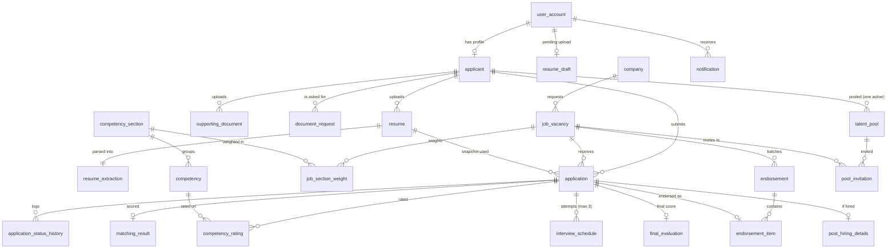

# VERA — Database Schema

> **Source of truth:** `supabase/migrations/20261006000000_initial_schema.sql`
> If this document and the SQL disagree, the SQL wins. Update both in the same PR.
> Related: [PRD](./PRD.md) · [TRD](./TRD.md) · [APP_FLOW](./APP_FLOW.md)

---

## 1. Conventions

| Rule | Example |
|---|---|
| Table names are **singular** snake_case | `application`, `supporting_document` |
| Primary key is `<table>_id`, type `uuid` (default `gen_random_uuid()`) | `application_id` |
| `user_account_id` **equals** `auth.users.id` (Supabase Auth) | — |
| Timestamps are `timestamptz`, named `*_at` | `created_at`, `verified_at`, `due_at` |
| Every mutable table has `updated_at`, maintained by a trigger | `set_updated_at()` |
| Scores are `numeric(5,2)` on a **0–100** scale | `matching_score = 72.50` |
| Status columns use Postgres **enums** | `application_status` |
| Age is **never stored**; it is computed from `birthdate` | `v_applicant_profile.age` |
| Ranks are **never stored**; they are computed with window functions | see §6 |
| Files live in Supabase Storage; tables store the **path** only | `resumes/<applicant_id>/<uuid>.pdf` |
| Schema changes = **new migration file**. Never edit an applied migration | — |

---

## 2. Entity Relationship Diagram



---

## 3. Table reference

### 3.1 Accounts

**`user_account`** — one row per Supabase Auth user, created by trigger **only after the email is confirmed**.
- `role` ∈ `admin | hr | applicant`. Set from `auth.users.raw_app_meta_data.vera_role` (only the service role can write app_metadata). Default `applicant`.
- `auth_provider` ∈ `email | google`. `full_name` is for staff.
- No `username` / `password_hash`: Supabase Auth owns credentials.
- *Decision 39-4 (Oct 25, 2026; migration `20261025000000_account_deactivation_reason.sql`):* **`deactivation_reason text null`**: HR's reason while an **applicant** account is inactive (set by Deactivate on Applicant Management, null again on Activate; HR / admin only, never sent to the applicant; length 5–500 checked by zod, no DB constraint). The migration backfilled it from the active (else latest) `talent_pool.remarks` of applicants inactive at the time and cleared those remarks, so the reason has one home. Staff accounts do not use it.

### 3.2 Applicant side

**`applicant`** — the confirmed profile. Created only when the applicant confirms the auto-filled card.
- Fields: names, `suffix`, `contact_number`, `birthdate`, `gender`, `height_cm` (optional), `address_line`, `city` (municipality), `province`, `education_level`.
- Age: `v_applicant_profile.age`.

**`resume_draft`** — holds an uploaded PDF + svc extraction between *upload & parse* and *confirm*. One row per user, replaced on every parse, deleted on confirm. Used for first setup **and** resume replacement.

**`resume`** — the applicant's resume versions. Exactly **one** `is_current = true` per applicant (partial unique index).
- Replacing *(Phase 4, decision 16, `resumes.service.replaceResume`)*: the old resume always gets `is_current=false, archived_at=now()` (row and file kept); the new one is inserted with its `resume_extraction` in the same transaction.
- Replacement is **allowed during active applications**: every `application.resume_id` keeps pointing at the resume it was sent with, and HR screening, verification, interview scheduling and reused-ratings checks read **that** resume (`screening.repository.js` → `findApplicationResume`). New applications, pool matching and rematch read the current resume. Blocked while the applicant has a pending `pool_invitation` (rematch offer or job invitation), which stores matching from the current resume.
- A new resume starts with `verification_status = 'pending'` (verification reset). Verification stays per resume row, so verifying an archived resume for its application never touches the new one.

**`resume_extraction`** — 1:1 with `resume`. Stores `standardized_text`, `sections` (jsonb), `skills_text`, `experience_text`, `years_experience`, `extracted_profile` (for audit of the auto-fill), `warnings`. Matching runs from this row, so the PDF is never re-sent to the svc.

**`supporting_document`** — per applicant (not per application), so verification carries across applications. `document_type` cannot be `resume`. **Types written (decision 29, no migration):** only `certificate`, `diploma`, `other`; the API's zod schema refuses the older enum values, which stay in the enum unused (§4). Re-upload: the old row gets `is_current=false, replaced_at`. **Delete rule (Oct 19, decision 28; no migration):** in the same upload transaction, after the request fulfilment, the replaced row is **deleted** when it is still `pending` (HR never verified or rejected it) and **no foreign key references it**. Every FK to `supporting_document` is checked explicitly in `documents.repository.js → deleteUnusedDocuments`: `application_document.supporting_document_id` (on delete restrict), `document_request.target_document_id` and `document_request.fulfilled_document_id` (both on delete **set null**, so the database alone would not stop the delete). A new FK to this table must be added to that check. Otherwise the row stays (not current, hidden from the applicant). Its storage file is removed after the commit (a failure is logged with ids, never rolled back).
- **Verification is stored per applicant document** (`resume`, `supporting_document`), never per application or vacancy: a document verified once stays verified for every later application (rating reuse, rematch) until the applicant re-uploads it, which starts the new row at `pending` (FR-DOC-04).
- **Fully verified** (FR-SCR-06, S12): the application's resume (`application.resume_id`; decision 16 — the current one for every application made since the last replacement) and every current supporting document are `verified` and no `document_request` of the application is `pending`. There is no per-vacancy list of required types; HR requests anything missing (`apps/api/src/domain/verification.js` → `isFullyVerified`).
- **"New upload to verify"** (S12 marker for HR): a current document that is `pending` and either replaced an earlier copy (same type; for certificate/other the same label) or fulfilled a request (`screening.repository.js` → `NEW_UPLOAD`).

**`application_document`** *(Phase 4, decision 16, `20261021010000`)* — the supporting documents the applicant chose to attach when applying: `(application_id, supporting_document_id)` primary key, `attached_at`. Application deleted → links deleted (cascade); a linked document is never deleted (restrict; the Oct 19 re-upload delete skips linked rows). Only records what was sent with the application; verification stays per document (above). RLS on, no policies.

**`document_request`** — HR asks for a document or a new copy, with a mandatory `reason` and a `due_at` = now + `system_setting.response_deadline_days`. `document_type='resume'` means resume re-upload *(still not requestable by HR: the applicant replaces the resume in My Documents (decision 16), and the request flow was not extended)*. HR requests only `certificate`, `diploma`, or `other` (decision 29, same zod gate). A request aimed at a copy marks that copy `reupload_requested`. Uploading the requested type fulfils it (`fulfilled_document_id`). *Sprint:* no automatic expiry; after the deadline HR drops manually (FR-SCR-05).

### 3.3 Companies and vacancies

**`company`** — client company (name, industry, description, website) + contact person (name, position, email, number). Name unique (case-insensitive).

**`competency_section`** — the 3 Competency Profile sections: `section_code` A (Communication and Interpersonal Skills), B (Personal Effectiveness Skills and Traits), C (Job Specific Skills and Experience). *(migration 20261007000000, S9b)*

**`competency`** — the 15 Competency Profile **items** (`section_id`, `sort_order`): A = Oral Communication/Listening, Co-Worker Relations/Teamwork, Customer Relations; B = Problem Solving, Time Management, Quality, Initiative and Perseverance, Personal Integrity, Adaptability, Stress Tolerance, Self-Development, Commitment; C = Experience, Education / Training, Technical Skills. Seeded by the migration and `supabase/seed.sql`.

**`job_vacancy`** — the manpower request as a posting.
- Matcher inputs: `required_skills` (one per line), `experience_requirement` (title on line 1, duties after). `min_years_experience` is **unused since decision 11** (Oct 13, 2026: no minimum years; never read or written by the API, keeps its default 0) and is kept only so a rollback to the pre-team-test tag still runs; it is dropped in the final cleanup migration after the last clone rehearsal (ROADMAP).
- Prescreen (hard filters): `min_age`, `max_age`, `gender_requirement`, `min_education_level`, `min_height_cm`.
- Pipeline config: `slots_needed`, `shortlist_per_group` (**generated** = slots × 2), `application_cap` (≥ slots × 4), `endorsement_count` (≥ slots), `matching_threshold` (default 40), `passing_score`.
- `status` ∈ `draft | open | closed | endorsing | filled | archived`. Applicants only see `open`; they never see `company`.
- *Phase 3 (decision 17, `20261020010000`):* `pool_matched_at` (timestamptz, the last pool-matching run finished) and `pool_match_summary` (jsonb `{ invited, skipped, failed, finishedAt }`), written by the background run after a publish or **Run pool matching again** (TRD §6.3).

**`job_section_weight`** — one row per vacancy × section with `weight` (%, 0–100; 0 allowed). A **deferred constraint trigger** enforces that a vacancy's weights total exactly 100 (or 0 while a draft has none). The API additionally requires 100 before publishing and stores all 3 sections once any weight is set. Replaces `job_competency` (dropped in S9b; old weights were summed into sections).

### 3.4 Pipeline

**`application`** — one per applicant × vacancy (**unique**, so no re-applying).
- **One ongoing application per applicant** (BR-17, migration 20261008000000): partial unique index `application_one_ongoing_per_applicant` on `applicant_id` where the status is ongoing (`waiting_pool` … `endorsed`) or `hired`. The API checks first; the index stops simultaneous applies.
- `applicant_type` from the radio button; `resume_id` = the resume used at apply time.
- `application_source` = `direct | talent_pool | rematch` (talent_pool = applied through an invitation; `rematch` added in 20261010000000 for S17's accepted rematch offers, which start at `for_endorsement` and never occupy a shortlist slot: RANK-02 leaves them out of the occupied count, BR-23). `source_application_id` is not used for rating reuse; reuse is recorded on `final_evaluation.ratings_source_application_id` (BR-21).
- `verification_started_at` locks the applicant's shortlist slot (§6.2): set once (`where verification_started_at is null`) by HR's **first** verify, reject, or document-request action on that application (FR-SCR-03). A locked slot = `status = 'shortlisted' and verification_started_at is not null`; the shortlist refresh never displaces it. An applicant whose documents were already verified stays unlocked until HR acts.
- `action_due_at` is the deadline for the applicant's pending action on the application itself (endorsement confirmation). Document requests, interviews, and invitations carry their own deadlines. *Decision 37B (Oct 24, 2026; **no migration, no ERD change**): the endorsement is no longer confirmed, so `action_due_at` is never written any more (Notify moves `passed → for_endorsement` directly) and the API no longer reads it; the column stays (old rows; the close-out still clears it). `passed_awaiting_confirmation` occurs only on old rows; `archived` now means "removed from the endorsement by HR" (neutral; decision 39-3: removed at the final interview). The new notification types `endorsement_notice` / `endorsement_removed` need no migration (`notification_type` is text).*
- Every status change is written to **`application_status_history`** by trigger. The API sets `SET LOCAL vera.actor_id = '<uuid>'` per transaction so `changed_by` is recorded (null = system job).

**`matching_result`** — 1:1 with application. `matching_score` (0–100), sub-scores, matched/missing skills, `weights` used (`{"skills":1,"experience":0}` for first-time, `{"skills":0.5,"experience":0.5}` for experienced), `model_name`.

**`interview_schedule`** — one row per attempt; `attempt_number` 1–3 (original + max 2 reschedules). Only one open attempt per application (partial unique index `interview_one_open_per_application`; the API turns a violation into 409). `meeting_link` required (online only). `confirm_due_at` default now + 3 days.
- *Sprint (S13):* the API sets `confirm_due_at` = min(now + `response_deadline_days`, `scheduled_at`); HR's **Edit time** updates the open attempt in place (`attempt_number` stays 1 while reschedule requests are deferred); Mark no-show sets `expired` (unconfirmed) or `no_show` (confirmed). Status parameters are cast to `public.interview_status` in SQL.
- *Decision 37 (Oct 24, 2026; **no migration, no ERD change**):* interviews are **notify only**. A new attempt is inserted with `status = 'confirmed'` (= the interview is set; existing enum value reused) and the application moves `shortlisted → interview_confirmed`; `confirmed_at` stays **null** (the applicant never confirmed). `confirm_due_at` stays NOT NULL but is **no confirmation deadline** any more: Schedule, Edit time and an approved reschedule write the interview time into it, and no query treats it as a deadline (the applicant status panel no longer reads it; the applicant list no longer returns it; Mark no-show on a set attempt uses `scheduled_at` only). `pending_confirmation` and `interview_scheduled` remain only on old rows (their old no-show rule still reads `confirm_due_at`).
- The initial migration's comments on `interview_confirmed` ("other applications terminated") and `terminated` are out of date: confirming an interview does not touch any other application, because an applicant has at most one ongoing application (BR-17). Applied migrations are not edited.

**`competency_rating`** — rating 1–5 for **every one of the 15 items**, per application. Reuse source for talent-pool applicants (`v_latest_competency_rating`).

**`final_evaluation`** — 1:1 with application.
- `interview_score` = two-level WSM (ALGORITHM.md §4 WSM-01): section % = (mean item rating − 1) / 4 × 100, then Σ section weight × section % / 100 → 0–100; computed by the API.
- `section_scores` (jsonb) = `{"A": 83.33, "B": 75, "C": 75}` used for that score.
- `overall_rating` = **generated** 1–5 band of `interview_score` (80 / 60 / 40 / 20; WSM-02), informational only.
- `final_score` = **generated** `(matching_score + interview_score) / 2`.
- `passed` = **generated** `final_score >= passing_score` (snapshot).
- `ratings_source_application_id` = the application whose 15 `competency_rating` rows were used: itself (interviewed), or for a reused evaluation (BR-21, WSM-03) the **original interviewed application**. Resolved as: the applicant's most recent completed `final_evaluation` → its `ratings_source_application_id` → that application's ratings; a reused evaluation has no ratings of its own, so a chain of reuses always points back to the interview.
- *Sprint (S14):* written only by `POST /api/admin/applications/:id/evaluation[/reuse]`. The unique constraints `final_evaluation_application_id_key` and `competency_rating_application_id_competency_id_key` turn a double submit into 409 (any other violation stays a 500). The API reads back `final_score`, `passed`, and `overall_rating` and rolls back if they differ from its JS result; `passed` decides the status. No migration was needed.

**`endorsement` / `endorsement_item`** — an endorsement batch per vacancy sent to the company email, with the generated PDF form and XLSX summary. Each item stores `rank_at_endorsement`, `final_score`, and the client `outcome` (`pending | hired | not_hired`) recorded by HR. `client_interview_at` is **the client's final interview time** (decision 14, Phase 2: set by Schedule final interview and sent to the applicant; until Oct 2026 it was optional and recorded with the outcome), and `final_interview_details` (added in 20261019010000) holds HR's instructions for the applicant (never the company name). *Decision 37C (Oct 24):* the outcome stays `pending` through For training, For requirements and For orientation (the stage is the application status); **Deployed** writes `hired`; **Training failed** writes `not_hired` with `outcome_remarks` "Training failed" (no new enum value). *Decision 39-3 (Oct 25, 2026; **no migration, no ERD change**): the batch and its items are written by **Notify** (one batch per Notify, each item with `client_interview_at` + `final_interview_details`); there is no Create endorsement. **Remove** at the final interview keeps the item's outcome `pending` and sets `outcome_remarks` "Removed from endorsement" (like the close-out's "vacancy filled"; no enum change); the application becomes `archived`.*

**`post_hiring_details`** — training schedule, pre-employment requirements, orientation, deployment details, `training_status`.

- *Phase 4 (decision 20, `20261021000000`):* `application.reschedule_requests` (smallint 0–2, default 0) counts the applicant's interview reschedule requests, approved or declined. A request sets the open attempt to `reschedule_requested` (with `reschedule_reason`); approve sets it to `rescheduled` and inserts the next attempt (`attempt_number` + 1, at most 3); decline puts it back to `pending_confirmation` or `confirmed`. The one-open index already includes `reschedule_requested`.

### 3.5 Talent pool

**`talent_pool`** — `pool_reason` ∈ `did_not_pass | standby | not_hired | training_failed | not_selected | prescreen_failed | below_threshold | dropped` (`not_selected` added in 20261008000000; the last three in Phase 3, `20261020000000`: screening failures and drops enter the pool, decision 17 / answer 4). HR's pool view has two tabs (decision 18, `POOL_TABS`): **Waiting** = prescreen_failed, below_threshold, not_selected, dropped, did_not_pass, standby; **Returned by Client** = not_hired, training_failed. At most **one active entry** per applicant (`removed_at is null`). `availability` ∈ `available | invited | reapplied | unavailable`.
- *Decision 37D (Oct 24, 2026; **no migration, no ERD change**):* HR / admin deactivate an applicant's account from the Applicant Pool. The existing, until now unused, `remarks` holds HR's deactivation reason (HR only; null again on Activate) and `availability = 'unavailable'` (also unused until now) marks the entry while the account is inactive; the account itself is `user_account.account_status = 'inactive'` (as for staff). Pool matching (`listPoolCandidates`: account active and availability not unavailable; the invite re-check `isPoolEntryActive`: availability not unavailable) and the rematch (`findRematchSource.accountStatus`) skip it. Deactivation expires the entry's pending `pool_invitation` (either kind). A new entry (a later application ending) starts with `remarks` null and `available`, but an inactive applicant cannot apply, so this does not happen while inactive.
  - *Superseded in part by decision 39-4 (Oct 25, 2026):* the control moved to Applicant Management, and the reason now lives in `user_account.deactivation_reason` (§3.1); `talent_pool.remarks` is no longer written by the account control (the migration moved existing reasons and cleared them). `availability = 'unavailable'` keeps its 37D meaning.

**`pool_invitation`** — *S17 (decided Oct 10, 2026): the automatic rematch offer (PRD BR-23).* Manual HR invitations stay deferred (ROADMAP §6); the table is reused instead of the planned `rematch_run` / `rematch_candidate` tables (lean sprint version).
- One row per offered vacancy: `talent_pool_id` = the applicant's active pool entry (`not_hired`), `job_vacancy_id`, `status` ∈ `pending | accepted | declined | expired` (`invitation_status`), `invited_by` null = the system, `invited_at`, `due_at` (now + `response_deadline_days`, shown, not enforced), `responded_at`.
- Added in `20261011000000_rematch_offer.sql`: `applicant_type` (carried over), `matching` (jsonb `{ match, weights, matchingScore }` from svc /match, so the accept never calls svc), `matching_score`, `section_scores`, `interview_score`, `final_score`, `ratings_source_application_id` (the original interview, WSM-03 chain), `application_id` (set on accept). Both new foreign keys are ON DELETE SET NULL.
- `unique (talent_pool_id, job_vacancy_id)`: a re-run never offers a declined / expired vacancy again. Partial unique index `pool_invitation_one_pending on (talent_pool_id) where status = 'pending'`: one pending offer per pool entry (23505 → 409).
- **No svc call inside a transaction:** the scan (svc `/match` per vacancy) runs after the `not_hired` commit; one short transaction then writes the offer. A failed accept re-check commits the expiry first.
- **Accept** locks job_vacancy → applicant, re-checks everything, then creates the application (`source = 'rematch'`, `for_endorsement`) with a `matching_result` from the offer's `matching` and a `final_evaluation` whose `ratings_source_application_id` is the original interview; the offer becomes `accepted`, the pool entry is closed (`removed_at`, availability `reapplied`). A failed re-check sets `expired` (committed) and availability back to `available`; **decline** sets `declined` and availability `available`. While an offer is pending the pool entry's availability is `invited`.
- `final_evaluation.computed_by` is null for an accepted offer (computed by the system at accept).
- **`application_source`** `rematch` was added in S15 (`20261010000000`).
- Migration `20261011000000` applied and verified on the project database (Oct 10, 2026; check-s17 84/84).
- *Phase 3 (decision 17, `20261020010000`):* `kind` (`invitation_kind`: `rematch_offer` default, every older row; `job_invitation` = an invitation from pool matching on publish). A job invitation stores `applicant_type` (the pool entry's **source** type, answer 7), `matching` and `matching_score` (computed at publish; accept makes no svc call), `due_at` (shown, not enforced); `interview_score`, `final_score`, `ratings_source_application_id` stay null. `pool_invitation_one_pending` is unchanged and now means **one pending row of either kind** per pool entry; `unique (talent_pool_id, job_vacancy_id)` means an entry is never invited to the same vacancy twice. Accept → a normal application (`source = 'talent_pool'`, `waiting_pool`) with a `matching_result` from the invitation, then the shortlist refresh; decline → `declined`, availability `available`. When the vacancy leaves `open`, its pending job invitations become `expired` (availability `available`) in the same transaction (`domain/invitationExpiry.js`); rematch offers are not touched.

### 3.6 Notifications and settings

**`notification`** — in-app feed + email outbox (`email_status` ∈ `not_required | pending | sent | failed`). Types are catalogued in TRD §9.

**`system_setting`** — key/value (jsonb): `response_deadline_days` (3), `max_reschedules` (2), `interview_reminder_hours` (24), `default_matching_threshold` (40), `default_cap_multiplier` (8). Editable by HR/admin in Settings.

---

## 4. Enums

| Enum | Values |
|---|---|
| `user_role` | admin, hr, applicant |
| `education_level` (ordered) | elementary < junior_high < senior_high < vocational < college_undergraduate < college_graduate < postgraduate |
| `vacancy_status` | draft, open, closed, endorsing, filled, archived |
| `applicant_type` | first_time, experienced |
| `application_source` | direct, talent_pool, rematch (added in 20261010000000) |
| `application_status` | prescreen_failed, below_threshold, waiting_pool, shortlisted, interview_scheduled, interview_confirmed, did_not_pass, passed, passed_awaiting_confirmation, for_endorsement, endorsed, hired, not_hired, training_failed, standby, terminated, dropped, archived, not_selected (added in 20261008000000; re-added idempotently by 20261010010000, which the real database needed), final_interview_scheduled, for_hiring (Phase 2, 20261019000000; both ongoing), for_training, for_requirements, for_orientation (decision 37C, 20261024000000; all ongoing; `hired` is shown as **Deployed** and `for_hiring` is kept for old rows only) |
| `verification_status` | pending, verified, rejected, reupload_requested |
| `document_type` | resume, transcript_of_records, diploma, nbi_clearance, police_clearance, barangay_clearance, valid_id, birth_certificate, certificate, medical_certificate, other. **In use (decision 29):** applicants upload and HR requests only `certificate`, `diploma`, `other` (`resume` only as the never-used resume request). The other values stay in the enum unused: Postgres cannot drop an enum value, and recreating the type was not worth the risk (no migration) |
| `interview_status` | pending_confirmation, confirmed, reschedule_requested, rescheduled, completed, no_show, expired, cancelled |
| `pool_reason` | did_not_pass, standby, not_hired, training_failed, not_selected (added in 20261008000000; re-added idempotently by 20261010010000), prescreen_failed, below_threshold, dropped (Phase 3, 20261020000000) |
| `invitation_kind` | rematch_offer, job_invitation (Phase 3, 20261020010000) |

**Active** application statuses (counted as "in progress"; they no longer block resume replacement, decision 16): `waiting_pool, shortlisted, interview_scheduled, interview_confirmed, passed, passed_awaiting_confirmation, for_endorsement, endorsed, final_interview_scheduled, for_hiring, for_training, for_requirements, for_orientation` — function `is_active_application_status()` (final_interview_scheduled and for_hiring added by 20261019010000, the three stages by 20261024010000 (decision 37C); each rebuilt `application_one_ongoing_per_applicant` and `application_active_idx` with them).

**Outcome classes** (BR-17..BR-19, decided Oct 7, 2026; `APPLICATION_OUTCOME` in `@vera/shared`):

| Class | Statuses | Effect |
|---|---|---|
| ongoing | the 13 active statuses above (8 + Phase 2's two + decision 37C's three) | blocks applying (one ongoing application at a time) |
| hired | hired (shown as Deployed) | blocks applying; *decision 37C:* Deployed is final (training failed comes before it, at For training) |
| failed | did_not_pass, not_hired, training_failed, dropped | frees the applicant **and** blocks every vacancy of that company for them (the agency or client assessed and rejected them, or they did not follow through) |
| neutral | prescreen_failed, below_threshold, not_selected, standby, archived, terminated | frees the applicant; no company block |

---

## 5. Changes from the existing ERD (Chapter 3)

| Existing | Now | Why |
|---|---|---|
| `user_account.username`, `password_hash` | removed | Supabase Auth stores credentials; duplicating hashes is a security risk |
| `user_account.date_created` | `created_at` (+ `updated_at`) | one timestamp convention |
| `applicant.address`, `city`, `province` | `address_line`, `city`, `province` | matches the profile card (house/street, municipality, province) |
| — | `applicant.education_level` | needed for prescreening and the profile card |
| `applicant.height` | `height_cm` (optional) | unit in the name; optional prescreen |
| `applicant.status` | removed | status belongs to each **application**; dashboards derive counts |
| `applicant.registration_date` | `created_at` / `profile_confirmed_at` | convention |
| `company.user_account_id` | `created_by` | it records who added the company, not ownership |
| — | `company.description`, `website`, `contact_person_position` | required by the spec and the UI mockups |
| `job_profile` | **`job_vacancy`** | matches UI and PRD wording; column set expanded (prescreen + pipeline config) |
| `job_profile.number_of_vacancy` | `slots_needed` (+ generated `shortlist_per_group`) | clarity |
| `job_profile.required_qualifications` | split into prescreen columns | machine-checkable hard filters |
| — | `resume_draft` | supports "confirm before saving" without re-uploading |
| `resume.resume_file` | `file_path`, `original_filename`, `file_size_bytes`, verification columns | storage path + resume verification/reset |
| `supporting_documents` | `supporting_document` | singular naming; adds `is_current`, `replaced_at` |
| — | `document_request` | request with reason + 3-day deadline |
| `matching_result.rank_number` | removed | ranks change constantly; computed by query |
| `interview_schedule.interview_date` + `interview_time` | `scheduled_at` (timestamptz) | one column, timezone-safe |
| `interview_schedule.attendance_status` | `status` + `attempt_number`, `confirm_due_at` | confirmation, max 2 reschedules |
| `interview_grading` (per schedule) | **`competency_rating`** (per application, all competencies) | enables talent-pool reuse with new weights |
| `final_evaluation.wsm_score`, `composite_score`, `rank_number`, `pass_status` | `interview_score`, generated `final_score`, generated `passed` | formula enforced in the DB |
| `endorsement` (per application) + `client_interview` | `endorsement` (batch) + `endorsement_item` | one email per company per vacancy; company interview handled outside VERA |
| `talent_pool.failed_stage`, `reason` | `pool_reason` enum + `remarks`, `removed_at` | consistent reasons; one active entry |
| — | `pool_invitation`, `application_status_history`, `system_setting` | invitations, audit trail, HR-adjustable deadlines |
| `notification.read_status`, `date_sent` | `is_read`, `read_at`, `email_status`, `created_at` | in-app + email outbox |
| — | `user_account.deactivation_reason` (decision 39-4, Oct 25) | HR's reason for any inactive applicant account (one home; was `talent_pool.remarks`, which only pool entries had). ERD: attribute only on `user_account`, no new entity or relationship |

---

## 6. Key queries (patterns the API must use)

### 6.1 Prescreen (in the API, before inserting the application)

```sql
select
  (j.min_age is null or p.age >= j.min_age)
  and (j.max_age is null or p.age <= j.max_age)
  and (j.gender_requirement = 'any' or j.gender_requirement::text = p.gender::text)
  and (j.min_education_level is null or p.education_level >= j.min_education_level)
  and (j.min_height_cm is null or (p.height_cm is not null and p.height_cm >= j.min_height_cm))
  as passes
from public.v_applicant_profile p, public.job_vacancy j
where p.applicant_id = $1 and j.job_vacancy_id = $2;
```

### 6.2 Shortlist refresh (run after every new application, drop, or expiry)

Per vacancy and per `applicant_type`:
1. `quota = shortlist_per_group`.
2. `occupied` = applications of that group in `shortlisted` **with** `verification_started_at` not null, **plus** every application of that group already past screening that has not been removed (`interview_scheduled`, `interview_confirmed`, `passed`, `did_not_pass`, `passed_awaiting_confirmation`, `for_endorsement`, `endorsed`, `standby`, `hired`, `not_hired`, `training_failed`, `archived`, and since Phase 2 `final_interview_scheduled`, `for_hiring`). Every application of the group counts, including invitations and applications whose ratings will be reused (BR-21; the old talent-pool exclusion was removed in S11b).
3. `candidates` = applications of that group in `waiting_pool` **or** unlocked `shortlisted`, ordered by `matching_score desc, applied_at asc, application_id asc` (sorted in JS, `selectShortlist`).
4. The top `quota - occupied` candidates become `shortlisted`; the rest of the unlocked `shortlisted` go back to `waiting_pool`.

Run it inside one transaction with `select ... for update` on the vacancy row so two requests cannot shortlist concurrently.

> Drops **before** the evaluation (verification failed, no response, interview expired/no-show) free a slot and the next in line moves up. After evaluation, slots are not refilled automatically (see PRD §9 open decision D1).

### 6.3 Interview score (WSM) for an application

```sql
-- $1 = application being evaluated, $2 = application whose ratings are used (same id, or the pooled one)
-- Exact hundredths, half-up (Postgres round() on numeric); same steps as apps/api/src/domain/scoring.js (S14).
with section_pct as (
  select c.section_id,
         round((sum(cr.rating) - count(*))::numeric * 2500 / count(*)) as pct_hundredths   -- section % × 100
  from public.competency_rating cr
  join public.competency c on c.competency_id = cr.competency_id
  where cr.application_id = $2
  group by c.section_id
)
select round(sum(round(w.weight * 100) * sp.pct_hundredths) / 10000) / 100 as interview_score
from public.application a
join public.job_section_weight w on w.job_vacancy_id = a.job_vacancy_id
join section_pct sp on sp.section_id = w.competency_section_id
where a.application_id = $1;
```

Every interview rates all 15 items (the evaluation endpoint refuses fewer), so the source application always has them; the API computes the same numbers in JS (`packages/shared/src/scoring.js`) and refuses a source without all 15 ratings (422).

Worked example without tables (should return **77.50**):
```sql
with ratings (section, rating) as (values
  ('A',5),('A',4),('A',4),
  ('B',4),('B',4),('B',4),('B',4),('B',5),('B',4),('B',3),('B',4),('B',4),
  ('C',4),('C',4),('C',4)),
weights (section, weight) as (values ('A', 30.00), ('B', 30.00), ('C', 40.00)),
pct as (select section, round((sum(rating) - count(*))::numeric * 2500 / count(*)) as h from ratings group by section)
select round(sum(round(w.weight * 100) * p.h) / 10000) / 100 as interview_score
from pct p join weights w using (section);
```

### 6.4 Final ranking for a vacancy (combined groups)

```sql
select a.application_id, a.applicant_type, a.status, fe.matching_score, fe.interview_score, fe.final_score, fe.passed,
       rank() over (order by fe.final_score desc, fe.matching_score desc, a.applied_at asc) as final_rank
from public.application a
join public.final_evaluation fe using (application_id)
where a.job_vacancy_id = $1
  and a.status in ('passed', 'did_not_pass', 'passed_awaiting_confirmation', 'for_endorsement', 'endorsed', 'standby');
```

### 6.5 Dashboard counts

*S18, decided Oct 11, 2026 (PRD FR-ADM-01).* There are 8 tiles, each defined once in `packages/shared/src/dashboard.js` (`DASHBOARD_TILES`). `apps/api/src/modules/dashboard/dashboard.repository.js → countTiles` counts all of them in **one statement** (one snapshot), with the status sets bound as `$1–$7`. Below is the same statement with the sets written out, so it can be run in the SQL Editor (TC-63; `scripts/check-s18.ps1` prints it from the API's own tile definitions):

```sql
select
  (select count(*)::int from public.applicant)                                         as "applicants",
  (select count(distinct a.applicant_id)::int from public.application a
    where a.status = any(array['waiting_pool']::public.application_status[]))           as "waitingPool",
  (select count(distinct a.applicant_id)::int from public.application a
    where a.status = any(array['shortlisted']::public.application_status[]))            as "forScreening",
  (select count(distinct a.applicant_id)::int from public.application a
    where a.status = any(array['interview_scheduled','interview_confirmed']::public.application_status[])) as "forInterview",
  (select count(distinct a.applicant_id)::int from public.application a
    where a.status = any(array['for_endorsement','endorsed','final_interview_scheduled','for_hiring',
                               'for_training','for_requirements','for_orientation']::public.application_status[])) as "forEndorsement",
  (select count(distinct a.applicant_id)::int from public.application a
    where a.status = any(array['hired']::public.application_status[]))                  as "hired",
  (select count(*)::int from public.talent_pool tp
    where tp.removed_at is null
      and not exists (select 1 from public.application b
                       where b.applicant_id = tp.applicant_id
                         and b.status = any(array['waiting_pool','shortlisted','interview_scheduled','interview_confirmed',
                                                  'passed','passed_awaiting_confirmation','for_endorsement','endorsed',
                                                  'final_interview_scheduled','for_hiring',
                                                  'for_training','for_requirements','for_orientation',
                                                  'hired']::public.application_status[])))      as "applicantPool",
  (select count(*)::int from public.job_vacancy v
    where v.status = any(array['open','closed','endorsing']::public.vacancy_status[]))   as "activeVacancies";
```

| Tile | Counts | Bound from |
|---|---|---|
| Total applicants | every `applicant` row (confirmed profile), applied or not | — |
| Waiting pool · For screening · For interview · For endorsement · Hired | distinct applicants with an application in the tile's `statuses` | `$1`–`$5` |
| Applicant pool | active pool entries whose applicant has no ongoing or hired application (`BLOCKS_APPLYING_STATUSES`) | `$6` |
| Active vacancies | vacancies in `open`, `closed` (cap reached or HR pause; keeps its waiting pool, BR-22), `endorsing` | `$7` |

- **Status tiles:** every status they use is ongoing or hired, so `application_one_ongoing_per_applicant` allows one such application per applicant. `distinct` is only defensive. `passed` and `passed_awaiting_confirmation` are counted in no tile, and neither is any final status. `draft`, `filled` and `archived` vacancies are not active.
- **Applicant pool:** the condition is `apps/api/src/domain/pool.js → freePoolEntry(alias, blockingParam)`, the same fragment used by `GET /api/admin/pool` (S17 pool page) and the Applicant Management `applicantPool` filter. `removed_at is null` alone is not enough: an active entry stays behind when the applicant applies elsewhere (ROADMAP S17, note from S15). `talent_pool_one_active_entry` allows one active entry per applicant, so `count(*)` counts applicants.
- **No filtering:** real counts; test data (`ZZ Check` vacancies, throwaway accounts) is counted like anything else.
- **Applicant Management list** (`applicants.repository.js`): the current application is picked with `distinct on (a.applicant_id) … order by a.applicant_id, (a.status = any(<BLOCKS_APPLYING_STATUSES>)) desc, a.updated_at desc, a.application_id desc`. Each status filter keeps the applicants whose current application is in the tile's set, and `applicantPool` uses `freePoolEntry`. So the list total for a filter equals that tile (check-s18 compares them on the real data).
- **Upcoming interviews:** `interview_schedule.status in ('pending_confirmation','confirmed','reschedule_requested')`, application `interview_scheduled` / `interview_confirmed`, `scheduled_at >= (date_trunc('day', now() at time zone 'Asia/Manila') at time zone 'Asia/Manila')` (decision 40-2: from midnight today, Philippine time; was `scheduled_at >= now()`, which dropped an interview the moment it started), `order by scheduled_at, interview_schedule_id limit 10`. Query only; no schema change.

---

### 6.6 Apply eligibility (BR-17, BR-19)

```sql
-- BR-17: the applicant's ongoing or hired application (API: 409); the unique index
-- application_one_ongoing_per_applicant enforces the same rule in the database.
select a.status, v.job_title
from public.application a join public.job_vacancy v using (job_vacancy_id)
where a.applicant_id = $1
  and a.status = any($2::public.application_status[])   -- ongoing statuses + 'hired'
limit 1;

-- BR-19: leave out vacancies of companies where this user has a FAILED application
-- (did_not_pass, not_hired, training_failed, dropped) from the LAST YEAR (decision 5, Oct 13, 2026).
-- The failed date is status_changed_at: failed statuses are final, so it is when the application failed.
-- Only job_vacancy.company_id is compared: no company table, no company columns reach the applicant.
select v.job_vacancy_id, v.job_title
from public.job_vacancy v
where v.status = 'open'
  and not exists (
    select 1
    from public.application fa
    join public.applicant fp on fp.applicant_id = fa.applicant_id
    join public.job_vacancy fv on fv.job_vacancy_id = fa.job_vacancy_id
    where fp.user_account_id = $1
      and fv.company_id = v.company_id
      and fa.status = any($2::public.application_status[])     -- failed statuses
      and fa.status_changed_at > now() - make_interval(years => 1));   -- COMPANY_BLOCK_YEARS
```
One fragment (`apps/api/src/domain/eligibility.js → atFailedCompany`), used by `GET /api/applicant/vacancies` (list and detail), `POST /api/applicant/applications` (pre-check and under-lock re-check), the rematch scan (`listRematchVacancies`), and the rematch accept re-check. Read-only audit: `select count(*) from public.application where status in ('did_not_pass','not_hired','training_failed','dropped') and status_changed_at <= now() - interval '1 year';` → failed applications that no longer block.

### 6.7 Pool-matching candidates (Phase 3, decision 17)
Run once per pool-matching run, outside any transaction (`invitations.repository.js → listPoolCandidates`); each candidate is then prescreened, matched by svc, and re-checked under the locks before the invite.
```sql
select tp.talent_pool_id, p.applicant_id, p.user_account_id, sa.applicant_type   -- the entry's SOURCE type (answer 7)
from public.talent_pool tp
join public.applicant p on p.applicant_id = tp.applicant_id
join public.application sa on sa.application_id = tp.source_application_id
where tp.removed_at is null
  and not exists (select 1 from public.application b                          -- BR-17: ongoing or hired
                  where b.applicant_id = tp.applicant_id and b.status = any($2::public.application_status[]))
  and not exists (select 1 from public.pool_invitation pi                     -- one pending row of either kind
                  where pi.talent_pool_id = tp.talent_pool_id and pi.status = $3)
  and not exists (select 1 from public.pool_invitation pi                     -- never invited to this vacancy
                  where pi.talent_pool_id = tp.talent_pool_id and pi.job_vacancy_id = $1)
  and not exists (select 1 from public.application x                          -- never applied here
                  where x.applicant_id = tp.applicant_id and x.job_vacancy_id = $1)
  and not <atFailedCompany(p.user_account_id, $4)>;                           -- BR-19, 1 year (§6.6)
```
The exact text lives in the repository; the fragments are `freePoolEntry` (`domain/pool.js`) and `atFailedCompany` (`domain/eligibility.js`).

## 7. Applying this schema to your existing Supabase project

Your current project already has `user_account` and `applicant` (old columns). It only holds test data, so the simplest path is:

1. Back up anything you want to keep (`Table Editor → Export`).
2. Drop the old `public` tables (and any test users in `auth.users`).
3. Run `supabase/migrations/20261006000000_initial_schema.sql`, then `supabase/migrations/20261007000000_competency_profile_rubric.sql`, then `supabase/migrations/20261008000000_one_ongoing_application.sql`, then `supabase/migrations/20261010000000_application_source_rematch.sql`, then `supabase/migrations/20261010010000_close_out_values.sql`, then `supabase/migrations/20261010020000_one_ongoing_index_repair.sql`, then `supabase/migrations/20261011000000_rematch_offer.sql`, then `supabase/seed.sql` (SQL Editor, or `supabase db push` with the CLI).

**Verifying the S9b rubric migration** (run after `20261007000000_competency_profile_rubric.sql`):
```sql
-- 1. Sections and items: A 3, B 9, C 3
select s.section_code, count(c.competency_id) as items
from public.competency_section s left join public.competency c on c.section_id = s.competency_section_id
group by s.section_code order by s.section_code;

-- 2. The 15 items in order
select s.section_code, c.sort_order, c.competency_name
from public.competency c join public.competency_section s on s.competency_section_id = c.section_id
order by c.sort_order;

-- 3. The old table is gone (expect NULL)
select to_regclass('public.job_competency');

-- 4. Every vacancy's section weights total 0 or 100 (expect no rows)
select job_vacancy_id, sum(weight) from public.job_section_weight group by job_vacancy_id having sum(weight) not in (0, 100);
-- and the converted weights, e.g. Cashier → A 30 / B 30 / C 40
select v.job_title, s.section_code, w.weight
from public.job_section_weight w
join public.job_vacancy v using (job_vacancy_id)
join public.competency_section s using (competency_section_id)
order by v.job_title, s.section_code;

-- 5. New final_evaluation columns and their expressions
select column_name, data_type, is_generated, generation_expression
from information_schema.columns
where table_schema = 'public' and table_name = 'final_evaluation'
  and column_name in ('section_scores', 'overall_rating', 'final_score', 'passed');

-- 6. Rounding: expect 78.41 and 4
select round((79.31 + 77.50) / 2, 2) as final_score,
       case when 77.50 >= 80 then 5 when 77.50 >= 60 then 4 when 77.50 >= 40 then 3 when 77.50 >= 20 then 2 else 1 end as overall_rating;
```
Then run the §6.3 worked-example query (expect 77.50).

**Verifying the S11b migration** (run after `20261008000000_one_ongoing_application.sql`):
```sql
-- 1. New enum values (expect one row each)
select enumlabel from pg_enum where enumtypid = 'public.application_status'::regtype and enumlabel = 'not_selected';
select enumlabel from pg_enum where enumtypid = 'public.pool_reason'::regtype and enumlabel = 'not_selected';

-- 2. The one-ongoing index and its predicate
select indexdef from pg_indexes where schemaname = 'public' and indexname = 'application_one_ongoing_per_applicant';

-- 3. No applicant has more than one ongoing-or-hired application (expect no rows)
select applicant_id, count(*) from public.application
where status in ('waiting_pool','shortlisted','interview_scheduled','interview_confirmed','passed',
                 'passed_awaiting_confirmation','for_endorsement','endorsed','hired')
group by applicant_id having count(*) > 1;

-- 4. The rating-reuse comment is in place
select col_description('public.final_evaluation'::regclass,
  (select attnum from pg_attribute where attrelid = 'public.final_evaluation'::regclass and attname = 'ratings_source_application_id'));
```

**Verifying the S15 migrations** (run after `20261010000000_application_source_rematch.sql` and `20261010010000_close_out_values.sql`, then restart `pnpm dev`):
```sql
-- 1. Every enum value S15 writes (expect 5 rows, present = true on each)
select t.typname, v.value, exists (
         select 1 from pg_enum e where e.enumtypid = t.oid and e.enumlabel = v.value) as present
from (values ('application_source', 'rematch'), ('application_status', 'not_selected'),
             ('pool_reason', 'not_selected'), ('pool_reason', 'standby'),
             ('interview_status', 'cancelled')) as v (typname, value)
join pg_type t on t.typname = v.typname and t.typnamespace = 'public'::regnamespace
order by t.typname, v.value;

-- 2. No application uses 'rematch' yet (expect 0)
select count(*) from public.application where application_source = 'rematch';

-- 3. The S11b index is in place (20261008000000, repaired by 20261010020000; expect one row whose predicate lists
--    the 8 ongoing statuses + hired).
select indexdef from pg_indexes where schemaname = 'public' and indexname = 'application_one_ongoing_per_applicant';
```

**Verifying the S11b repair** (run after `20261010020000_one_ongoing_index_repair.sql`, then restart `pnpm dev`):
```sql
-- 1. The unique index and its predicate (expect one row:
--    CREATE UNIQUE INDEX application_one_ongoing_per_applicant ON public.application USING btree (applicant_id)
--    WHERE (status = ANY (ARRAY['waiting_pool', ..., 'endorsed', 'hired']::application_status[])))
select indexdef from pg_indexes where schemaname = 'public' and indexname = 'application_one_ongoing_per_applicant';

-- 2. It is valid and unique (expect indisunique = true, indisvalid = true)
select i.indisunique, i.indisvalid from pg_index i
where i.indexrelid = 'public.application_one_ongoing_per_applicant'::regclass;

-- 3. No applicant has more than one ongoing-or-hired application (expect no rows)
select applicant_id, count(*) from public.application
where status in ('waiting_pool','shortlisted','interview_scheduled','interview_confirmed','passed',
                 'passed_awaiting_confirmation','for_endorsement','endorsed','hired')
group by applicant_id having count(*) > 1;

-- 4. The rating-reuse comment is in place (expect the "Application whose 15 competency_rating rows…" text)
select col_description('public.final_evaluation'::regclass,
  (select attnum from pg_attribute where attrelid = 'public.final_evaluation'::regclass and attname = 'ratings_source_application_id'));
```

**Verifying the S17 migration** (run after `20261011000000_rematch_offer.sql`, then restart `pnpm dev`):
```sql
-- 1. The new pool_invitation columns (expect 8 rows)
select column_name, data_type from information_schema.columns
where table_schema = 'public' and table_name = 'pool_invitation'
  and column_name in ('applicant_type', 'matching', 'matching_score', 'section_scores', 'interview_score',
                      'final_score', 'ratings_source_application_id', 'application_id')
order by column_name;

-- 2. One pending offer per pool entry (expect one row with "WHERE (status = 'pending'::invitation_status)")
select indexdef from pg_indexes where schemaname = 'public' and indexname = 'pool_invitation_one_pending';

-- 3. The two new foreign keys are ON DELETE SET NULL (expect confdeltype = 'n' twice)
select conname, confdeltype from pg_constraint
where conrelid = 'public.pool_invitation'::regclass and contype = 'f'
  and conname in ('pool_invitation_ratings_source_application_id_fkey', 'pool_invitation_application_id_fkey');
```
**Verifying the Phase 2 migrations** (decisions 14/15; run `20261019000000_final_interview_values.sql`, then `20261019010000_final_interview.sql`, then these, and only then restart `pnpm dev` with the Phase 2 code — the new API sends the new values in its ongoing-status lists):
```sql
-- 1. The last two labels are final_interview_scheduled, for_hiring
select enumlabel from pg_enum where enumtypid = 'public.application_status'::regtype order by enumsortorder;

-- 2. Expect t, t, f
select public.is_active_application_status('final_interview_scheduled'),
       public.is_active_application_status('for_hiring'), public.is_active_application_status('hired');

-- 3. Both index definitions list final_interview_scheduled and for_hiring (the unique one also 'hired')
select indexname, indexdef from pg_indexes
 where schemaname = 'public' and indexname in ('application_one_ongoing_per_applicant', 'application_active_idx');

-- 4. Expect 2 rows
select column_name from information_schema.columns
 where table_schema = 'public' and table_name = 'endorsement_item'
   and column_name in ('client_interview_at', 'final_interview_details');

-- 5. Juan unchanged: expect endorsed / pending / null
select a.status, i.outcome, i.client_interview_at
  from public.application a join public.applicant p using (applicant_id) join public.user_account u using (user_account_id)
  left join public.endorsement_item i using (application_id)
 where u.email = 'juan@vera.test' and a.job_vacancy_id = 'dc4c5084-7d53-4da9-933e-e6ec91f492db';
```
`notification.notification_type` is plain text, not an enum: the Phase 2 notification types need no migration.

**Verifying the Phase 3 migrations** (decisions 17/18; run `20261020000000_pool_reason_values.sql`, then `20261020010000_job_invitation.sql`, then these, and only then restart `pnpm dev` with the Phase 3 code — the new API sends the new pool reasons and reads `kind`):
```sql
-- 1. pool_reason ends with prescreen_failed, below_threshold, dropped
select enumlabel from pg_enum where enumtypid = 'public.pool_reason'::regtype order by enumsortorder;

-- 2. invitation_kind = rematch_offer, job_invitation
select enumlabel from pg_enum where enumtypid = 'public.invitation_kind'::regtype order by enumsortorder;

-- 3. Every existing row is a rematch offer (expect one row: rematch_offer, n; or no row)
select kind, count(*) from public.pool_invitation group by kind;

-- 4. The one-pending index is unchanged (expect ... WHERE (status = 'pending'::invitation_status))
select indexdef from pg_indexes where schemaname = 'public' and indexname = 'pool_invitation_one_pending';

-- 5. Expect 2 rows
select column_name from information_schema.columns
 where table_schema = 'public' and table_name = 'job_vacancy' and column_name in ('pool_matched_at', 'pool_match_summary');
```
`application_source` already has `talent_pool` (initial schema); the Phase 3 notification types need no migration.

**Verifying the Phase 4 migration** (decision 20; run `20261021000000_reschedule_requests.sql`, then these, then restart `pnpm dev` with the Phase 4 code — the API reads `reschedule_requests`):
```sql
-- 1. Expect: reschedule_requests | smallint | 0 | NO
select column_name, data_type, column_default, is_nullable from information_schema.columns
 where table_schema = 'public' and table_name = 'application' and column_name = 'reschedule_requests';

-- 2. Expect one CHECK: ((reschedule_requests >= 0) AND (reschedule_requests <= 2))
select pg_get_constraintdef(oid) from pg_constraint
 where conrelid = 'public.application'::regclass and pg_get_constraintdef(oid) like '%reschedule_requests%';

-- 3. Expect 0 (nobody has a request yet)
select count(*) from public.application where reschedule_requests <> 0;

-- 4. Expect '2'
select setting_value from public.system_setting where setting_key = 'max_reschedules';

-- 5. Expect ... WHERE (status = ANY (ARRAY['pending_confirmation'::interview_status, 'confirmed'::interview_status, 'reschedule_requested'::interview_status]))
select indexdef from pg_indexes where schemaname = 'public' and indexname = 'interview_one_open_per_application';
```
User Management (decision 19) needs no migration: `user_account.account_status`, `created_by` and the auth trigger exist since the initial schema.

**Verifying the Phase 4 Part C migration** (decision 16; run `20261021010000_application_document.sql`, then these, then restart `pnpm dev` with the Part C code — apply writes `application_document`):
```sql
-- 1. Expect 3 rows: application_id uuid NO | supporting_document_id uuid NO | attached_at timestamp with time zone NO now()
select column_name, data_type, is_nullable, column_default from information_schema.columns
 where table_schema = 'public' and table_name = 'application_document' order by ordinal_position;

-- 2. Expect: t (RLS on)
select relrowsecurity from pg_class where oid = 'public.application_document'::regclass;

-- 3. Expect 0 (no policies: API only, rule 6)
select count(*) from pg_policies where schemaname = 'public' and tablename = 'application_document';

-- 4. Expect 3 rows: PRIMARY KEY (application_id, supporting_document_id);
--    FOREIGN KEY (application_id) REFERENCES application(application_id) ON DELETE CASCADE;
--    FOREIGN KEY (supporting_document_id) REFERENCES supporting_document(supporting_document_id) ON DELETE RESTRICT
select pg_get_constraintdef(oid) from pg_constraint
 where conrelid = 'public.application_document'::regclass order by contype desc;

-- 5. Expect 1 row: application_document_document_idx ... (supporting_document_id)
select indexdef from pg_indexes where schemaname = 'public' and indexname = 'application_document_document_idx';

-- 6. Expect 0 (new table)
select count(*) from public.application_document;
```

**Verifying the decision 37C migrations** (client-outcome stages, approved Oct 24 as C-a; run `20261024000000_outcome_stage_values.sql`, then `20261024010000_outcome_stages.sql`, then these, and only then restart `pnpm dev` with the Unit C code — the API sends the new values in its ongoing-status lists). Applied and verified by the owner on Oct 24:
```sql
-- 1. The last three labels are for_training, for_requirements, for_orientation (after for_hiring)
select enumlabel from pg_enum where enumtypid = 'public.application_status'::regtype order by enumsortorder;

-- 2. Expect t, t, t, f
select public.is_active_application_status('for_training'), public.is_active_application_status('for_requirements'),
       public.is_active_application_status('for_orientation'), public.is_active_application_status('hired');

-- 3. Both index definitions list the three stages (the unique one also 'hired', last)
select indexname, indexdef from pg_indexes
 where schemaname = 'public' and indexname in ('application_one_ongoing_per_applicant', 'application_active_idx');

-- 4. The unique index is unique and valid (expect t, t)
select i.indisunique, i.indisvalid from pg_index i
 where i.indexrelid = 'public.application_one_ongoing_per_applicant'::regclass;

-- 5. No row uses the new statuses yet (expect 0)
select count(*) from public.application where status in ('for_training', 'for_requirements', 'for_orientation');
```
`notification.notification_type` is plain text: the new notice types `for_training`, `for_requirements`, `for_orientation` need no migration. The endorsement item's outcome for Training failed reuses `endorsement_outcome = not_hired` (remarks "Training failed"); no enum change.

**Verifying the decision 39-4 migration** (applicant deactivation reason, approved Oct 25; run `20261025000000_account_deactivation_reason.sql`, then these, then restart `pnpm dev` with the Unit 4 code):
```sql
-- 1. The column: text, nullable, no default
select column_name, data_type, is_nullable, column_default
  from information_schema.columns
 where table_schema = 'public' and table_name = 'user_account' and column_name = 'deactivation_reason';

-- 2. Who has a reason: only inactive applicants; never staff, never active accounts
select role, account_status, count(*) as accounts, count(deactivation_reason) as with_reason
  from public.user_account
 group by role, account_status
 order by role, account_status;

-- 3. Inactive applicants without a reason (no pool remark to copy); ids only, no names
select u.user_account_id
  from public.user_account u
 where u.role = 'applicant' and u.account_status = 'inactive' and u.deactivation_reason is null;

-- 4. No pool entry of an inactive applicant still holds a remark (the reason has one home)
select count(*) as remarks_left
  from public.talent_pool tp
  join public.applicant p on p.applicant_id = tp.applicant_id
  join public.user_account u on u.user_account_id = p.user_account_id
 where u.account_status = 'inactive' and tp.remarks is not null;
```
Results on Oct 25, 2026: 1) one row `text`, `YES`, null; 2) admin 1, hr 1, applicant 6, all active, `with_reason` 0 everywhere (no inactive applicants, so nothing was backfilled); 3) no rows; 4) `remarks_left` 0.

**Checking the document types (decision 29; no migration, read-only)** — run once before the final test:
```sql
-- Expect 0 rows on the reset database. Later, only certificate / diploma / other may appear;
-- any other value would be legacy data (still shown with its label, but it cannot be re-uploaded as that type).
select 'supporting_document' as source, document_type::text, count(*) from public.supporting_document group by 2
union all
select 'document_request', document_type::text, count(*) from public.document_request group by 2;
```

4. Create the admin account with the seed script (TRD §7).

If you must keep data, write a new migration that `ALTER`s the old tables instead (rename `address → address_line`, drop `status`/`registration_date`, add `education_level`, etc.).

---

## 8. Concurrency and row locks

**One global lock order** for every transaction that locks more than one row (`select … for update`):

```
job_vacancy  →  applicant  →  application
```

A transaction may skip a level, but never locks an earlier level after a later one. Two transactions therefore always wait in the same direction and cannot deadlock. Every lock site has a comment pointing here.

| Transaction | Locks, in order | Code |
|---|---|---|
| Apply (S11/S11b) | job_vacancy (`lockVacancy`) → applicant (`lockApplicant`) → inserts the application; the shortlist refresh re-takes the same vacancy lock | `applications.service.js` |
| Verify / reject resume or document (S12) | job_vacancy → application | `screening.service.js` → `withShortlistedApplication` |
| Document request (S12) | job_vacancy → application | same |
| Drop (S12) | job_vacancy → applicant → application, then `refreshShortlist` (vacancy already held) | `screening.service.js` → `dropApplication` |
| Schedule interview / edit time / applicant confirm (S13) | job_vacancy → application; the attempt is read again after the application lock | `interviews.service.js` |
| Mark no-show (S13) | the Drop transaction above (job_vacancy → applicant → application); its `checkLocked` hook re-reads and closes the attempt under those locks | `interviews.service.js` → `markNoShow` |
| Evaluate (S14) | job_vacancy → applicant (the `talent_pool` entry is per applicant) → application; the latest attempt (with `scheduled_at <= now()`) and the application's matching/passing scores are read again after the application lock; then `competency_rating` × 15, `final_evaluation`, attempt → `completed`, status change, pool entry | `evaluations.service.js` → `evaluateApplication` |
| Reuse ratings (S14) | job_vacancy → applicant → application; verification, the WSM-03 source lookup, and the scores are read again after the application lock; then `final_evaluation`, status change, pool entry | `evaluations.service.js` → `reuseRatings` |
| Notify (S15) | job_vacancy → every selected application in one statement, ascending id (`order by a.application_id for update of a`); no applicant row (no pool entry). Vacancy status and places left are read under the vacancy lock; each application's status after its lock. *Decision 39-3: the same transaction writes the endorsement batch and items, both status moves, the notices, the vacancy status (endorsing) and, for an open job, the job-invitation expiry (vacancy already held); the place check runs after the application locks (only passed rows take a new place)* | `ranking.service.js` → `notifyApplicants` |
| ~~Applicant confirm / decline endorsement (S15)~~ | *Removed by decision 37B (Oct 24): no applicant answer* | — |
| ~~Remove from endorsement (decision 37B)~~ *(removed by decision 39-3)* | job_vacancy → application (no applicant row: no pool entry is written); the status is read again after the application lock (only `for_endorsement`; a Create endorsement or close-out that won → 409) | `endorsements.service.js` → `removeFromEndorsement` |
| Remove at the final interview (decision 39-3; replaces the row above) | job_vacancy → applicant → application (`lockItemApplication`; status `final_interview_scheduled` and the item outcome `pending` re-read under the lock), then the item's remarks and the status move | `endorsements.service.js` → `removeFromEndorsement(itemId)` |
| Archive + close-out (S15; fill in S16) | job_vacancy (the archive's `lockVacancy`, held by the caller) → every affected applicant in one statement, ascending id → every affected application in one statement, ascending id (`for update of a`), level by level; statuses read again under the application locks, then moved one by one in application-id order as the system | `vacancies.service.js` → `changeVacancyStatus` → `domain/closeOut.js` → `closeOutVacancy` |
| Create endorsement (S16) | job_vacancy → every affected applicant (for_endorsement + passed) in one statement, ascending id → every affected application, ascending id (`for update of a`); statuses re-read; endorsed moves as HR, standby moves as the system; vacancy → endorsing *(removed by decision 39-3: Notify writes the batch)* | `endorsements.service.js` → `createEndorsement` |
| Client decision (S16), incl. the fill | job_vacancy → this applicant **plus, when the hire will fill (hired count + 1 ≥ slots, read under the vacancy lock), every applicant `closeOutCandidates(…, "filled")` returns**, in one statement, ascending id → the endorsed application (status and item outcome re-read) → on fill, `closeOutVacancy` (its applicant locks are then already held, so no applicant is locked after an application) | `endorsements.service.js` → `recordOutcome` |
| Training failed (S16; decision 37C: by item, only at For training) | job_vacancy → applicant (pool entry) → application (status and item outcome re-read under the lock); the item outcome is written only while the application lock is held | `endorsements.service.js` → `markTrainingFailed` |
| Final interview / stage advance (Phase 2; decision 37C replaces For hiring) | job_vacancy → applicant → application (status and item outcome re-read under the lock); the endorsement item is written only while the application lock is held | `endorsements.service.js` → `scheduleFinalInterview`, `advanceStage` |
| Vacancy edit / publish / close / reopen (S9) | job_vacancy | `vacancies.service.js` |
| Rematch scan + offer (S17) | the scan (reads + svc `/match` per vacancy) runs with **no transaction**; then one transaction: applicant only (`lockApplicant`; no vacancy row is changed) → source, pool entry, BR-17, and pending offer re-read → insert `pool_invitation` (the `pool_invitation_one_pending` index is the last line) → pool availability `invited` → notices | `rematch.service.js` → `runRematch` |
| Rematch accept (S17) | job_vacancy (`lockVacancy`) → applicant (`lockApplicant`) → offer re-read; re-checks (vacancy status, endorsement count, BR-17, BR-19, applied, profile, scores) under these locks → inserts the application, `matching_result`, `final_evaluation`; offer `accepted`; pool entry closed. A failed re-check commits offer `expired` + availability + notice instead (then 409) | `rematch.service.js` → `answerOffer` |
| Pool-matching invite (Phase 3) | the run (candidate query, prescreen, svc `/match` per entry, 15 s timeout) has **no transaction**; then one transaction per invite: job_vacancy (`lockVacancy`; not open → the run stops) → applicant (`lockApplicant`) → re-check free entry, no pending row, not applied → `pool_invitation` + availability `invited` + notice | `invitations.service.js` → `runPoolMatching` |
| Job invitation accept / decline (Phase 3) | job_vacancy → applicant → invitation re-read; accept re-checks under these locks, inserts the application, then the shortlist refresh (vacancy already held) and the cap close-out | `invitations.service.js` → `answerInvitation` |
| Invitation expiry when a vacancy leaves open (Phase 3) | job_vacancy only, already held by the close / cap close / endorse / fill transaction. **Exception:** the vacancy's pending job invitations and their pool entries are updated without the applicant lock; safe because every other writer of a job invitation (invite, accept, decline) takes the same vacancy lock first, and the compare-and-set on `status = 'pending'` turns a late answer into a 409 | `domain/invitationExpiry.js` |
| Reschedule request / approve / decline (Phase 4) | job_vacancy → application; the attempt is re-read under the application lock and written only while it is held (compare-and-set on its status); approve inserts the next attempt and, for a confirmed application, uses `transition()` | `interviews.service.js` → `requestReschedule`, `approveReschedule`, `declineReschedule` |
| Resume replace (Phase 4, decision 16) | applicant only (`lockApplicant`), the same row apply, rematch offers and pool-matching invites lock; the pending-offer check is repeated under it, then archive old → insert new resume + extraction → delete draft. No vacancy or application row is touched. Known narrow window: a rematch scan or pool-matching run that called svc with the old resume **before** the replace committed can still insert its offer **after** it (its own re-checks do not compare resume ids); the stored matching is then from the previous resume. Accepted for the demo (seconds-wide, needs a publish or not-hired at that moment) | `resumes.service.js` → `replaceResume` |
| Supporting-document upload / re-upload (Oct 19, decision 28) | applicant only (`lockApplicant`), the same row apply locks before it checks and links current documents; then retire the old row → insert the new one → fulfil requests (+ staff notices) → `deleteUnusedDocuments` (the replaced row, if pending and unreferenced). So an apply either links the old copy first (the delete then keeps it) or sees it already not current (422). Known narrow window: an HR document request (job_vacancy → application, no applicant lock) that targets the old copy in the same instant gets `target_document_id` set to null by the FK and becomes a plain request for that type | `documents.service.js` → `uploadDocument` |
| Apply with attached documents (Phase 4, decision 16) | unchanged apply order (job_vacancy → applicant); the attached ids are checked against the applicant's current documents after the applicant lock, the links written after the application insert | `applications.service.js` → `applyToVacancy` |
| Deactivate staff (Phase 4) | the active **admin** `user_account` rows only, in id order (`for update`), so two admins deactivating each other cannot both pass the last-admin check; never combined with the job_vacancy order (no other row is locked). The Supabase ban runs after the commit | `users.service.js` → `changeAccountStatus` |
| Applicant account status (decision 39-4, Applicant Management; replaces the 37D row below) | the ongoing application's **job_vacancy** (if any) → **applicant** (`lockApplicant`) → **application**, the usual order; the ongoing application is re-read under the locks (changed → 409). Then `transition(→ archived)`, live interviews cancelled, pending document requests withdrawn, `refreshShortlist` under the same vacancy lock (waiting / shortlisted / agency interview), the endorsement item remarks (with the client), the pool entry's pending offer / invitation expired + availability, `user_account` status + reason. A free or Deployed applicant locks the applicant row only. The Supabase ban runs after the commit; the unban runs before the transaction | `applicants.service.js` → `changeApplicantAccountStatus` |
| ~~Applicant account status from the pool (decision 37D)~~ *(superseded by decision 39-4; route removed)* | applicant only (`lockApplicant`), the same row every `pool_invitation` writer locks (offer, invite, accept, decline); the entry and (deactivate) the BR-17 blocking check are re-read under it, then the pending offer / invitation → expired (compare-and-set), the entry's availability + remarks, `user_account.account_status`. No vacancy or application row. The Supabase ban runs after the commit; the unban runs before the transaction | `rematch.service.js` → `changePoolAccountStatus` |
| Rematch decline (S17) | job_vacancy → applicant → offer re-read → offer `declined` (compare-and-set on `status = 'pending'`) → availability `available` → staff notice | `rematch.service.js` → `answerOffer` |

- Screening actions take the **vacancy** lock first because the shortlist refresh locks the same row: a refresh can never demote an application in the moment HR locks it.
- Status writes use `statusMachine.transition`, whose `UPDATE … WHERE status = <read status>` turns a stale read into a 409 instead of overwriting.
- `interview_schedule` rows are written only while their **application** row is locked, so they need no lock of their own: a confirm and a no-show on the same interview queue on the application lock, and the second one re-checks and gets 409 (S13). The same holds for an evaluation and a no-show (S14): whichever commits first wins, the other sees `completed` / `dropped` and gets 409.
- `talent_pool` rows are written only while the **applicant** row is locked (`domain/pool.js → addToPool`: close the active entry, insert the new one), so the one-active-entry index is never hit by two writers (S14). The close-out (S15) locks all affected applicants before any application, in ascending id order, so two close-outs (or a close-out and an apply elsewhere) always wait in the same direction.
- `pool_invitation` rows are written only while the **applicant** row is locked (offer, accept, decline, expiry), with a compare-and-set on `status = 'pending'`, so a double click or two tabs get 409 (S17). Phase 3 exception: the job-invitation expiry when a vacancy leaves `open` holds only the vacancy lock (see the table).
- No svc call ever runs inside a transaction (CLAUDE.md rule 7).
